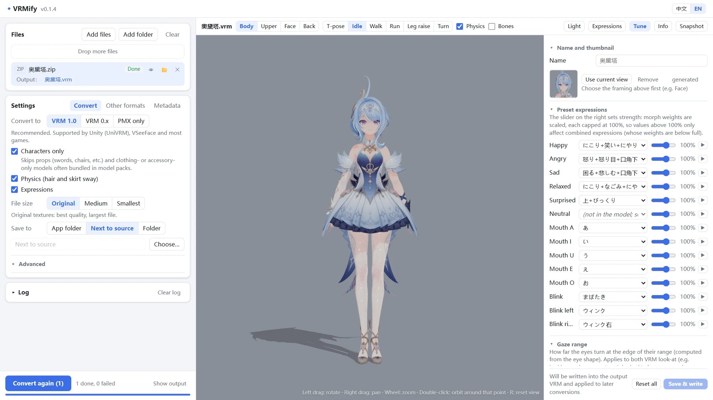
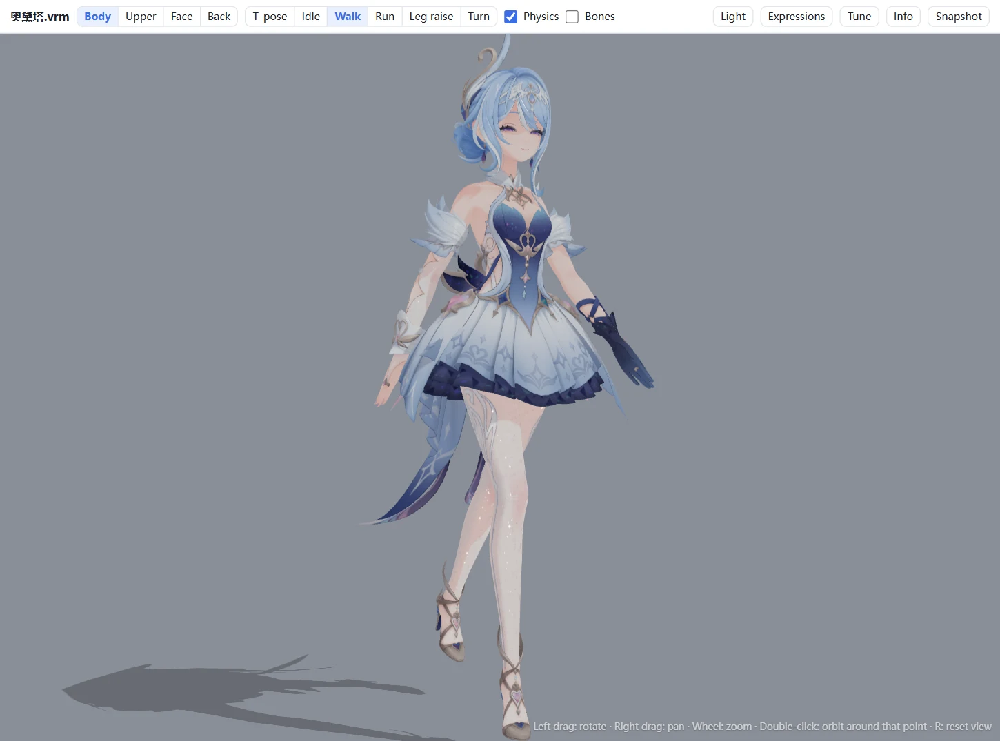
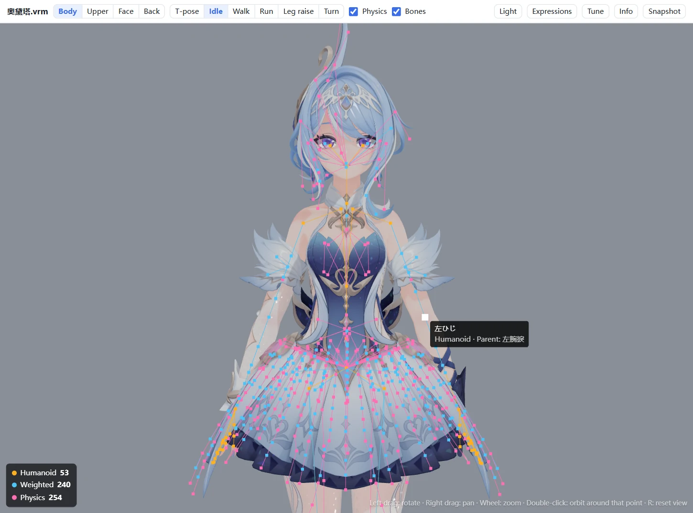
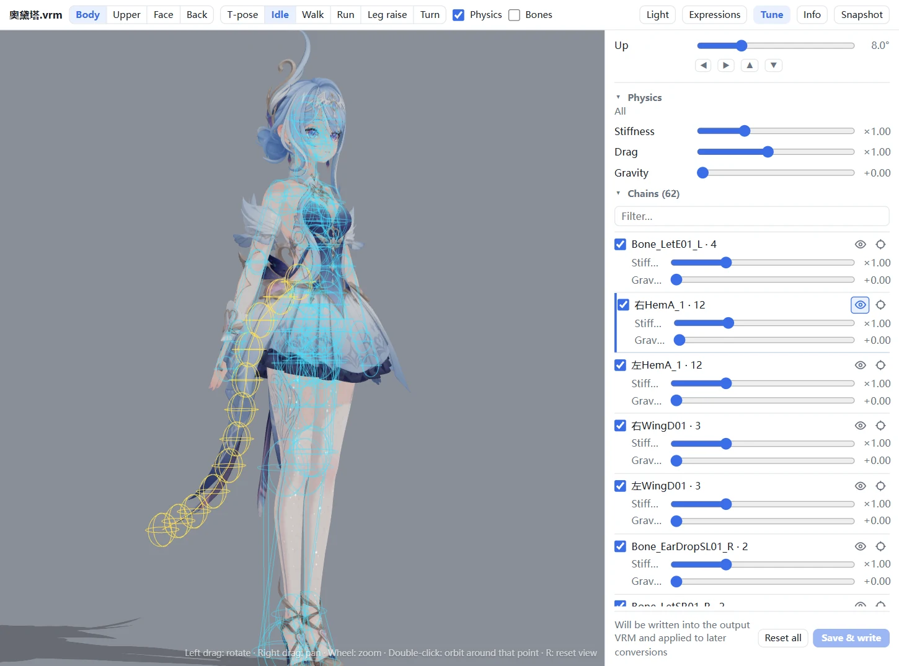
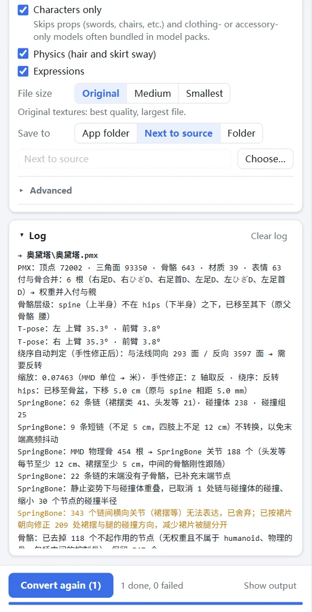

<p align="center">
  
</p>

<h1 align="center">VRMify</h1>

<p align="center">
  Turn MMD / PMX models — and FBX, unitypackage, Unreal and XNALara models — into VRM avatars.<br>
  Drop in a file or a whole archive, preview the result, done. No Blender, no Unity, no plugins.
</p>

<p align="center">
  <a href="https://github.com/JiGuang283/VRMify/releases/latest"></a>
  
  
  <a href="LICENSE"></a>
</p>

<p align="center">
  English | <a href="README_SC.md">简体中文</a>
</p>

<p align="center">
  
</p>

## Highlights

- **One window, nothing to install.** A portable exe for Windows. The converter itself is plain Python, so there
  is no Blender, Unity or add-on chain to set up.
- **Looks right out of the box.** MToon toon shading built from the PMX toon textures, transparency decided per
  texture, A-pose raised to T-pose, and VRoid-style emotion presets that move brows, eyes and mouth together.
- **Physics that moves like a native VRM.** PMX rigid bodies become VRM 1.0 SpringBone chains and colliders, with
  special care for skirts. Models without physics get hair, skirt and ribbon chains from their bone names.
- **A clean skeleton.** MMD, VRChat, Mixamo and Unity bone names map to the VRM humanoid; append (付与) bones, IK,
  tip and control bones that do nothing in VRM are merged or removed, leaving a VRoid-like hierarchy.
- **Feed it what model sites hand out.** Drop a zip, 7z or rar as is: models are found inside, props and
  outfit-only models are skipped, and garbled Japanese / Chinese file names in old zip files are restored.
- **See it before you use it.** A three-vrm preview (the same rules as UniVRM) with walk / run motions, expressions,
  and skeleton and collider overlays. Fix presets, physics, the gaze range or the thumbnail without converting again.
- **Valid output.** Output passes the official VRM JSON Schema and avoids the data that makes UniVRM imports
  fail.

## Screenshots

<table>
  <tr>
    <td width="50%"></td>
    <td width="50%"></td>
  </tr>
  <tr>
    <td><b>Preview</b>: idle, walk and run motions, lighting, expressions</td>
    <td><b>Skeleton overlay</b>: humanoid, weighted and physics bones; name and parent on hover</td>
  </tr>
  <tr>
    <td colspan="2" align="center">
      
      
    </td>
  </tr>
  <tr>
    <td colspan="2"><b>Tune</b>: presets, gaze and physics per chain, with the chain and its colliders shown ·
      <b>Log</b>: what was converted, merged or skipped</td>
  </tr>
</table>

<sub>Model in the screenshots: 奥黛塔 (provided by miHoYo, edited by 观海), shown under its terms of use.</sub>

## Quick start

1. Download `VRMify-v<version>-win64.zip` from [Releases](https://github.com/JiGuang283/VRMify/releases/latest),
   unzip it and run `VRMify.exe`.
2. Drag model files, folders or archives into the window and click **Start conversion**.
3. Click the eye icon next to a file to preview the VRM; adjust it in **Tune** if needed.

> [!NOTE]
> The exe isn't code-signed, so Windows may show "Windows protected your PC" the first time: click **More info →
> Run anyway**. The window uses the system WebView2 (built into Windows 11 and almost every Windows 10); without it
> the UI opens in your browser.

## Supported formats

| Input | |
|---|---|
| **PMX** (MMD) | the main path: skeleton, materials, morphs and physics are all converted |
| **FBX**, **unitypackage** | Unity / VRChat-style models; facing and texture alpha are detected |
| **uemodel** (UEFormat), **psk / pskx** (Unreal ActorX) | Unreal models; uemodel parts can be aligned to a full-body reference |
| **xps** (XNALara) | |
| **zip / 7z / rar** | models inside are found and converted; 7z / rar use 7-Zip, WinRAR, Bandizip or Windows' `tar` |
| **VRM** | opens in the preview and the Tune panel |

Output: **VRM 1.0** (with SpringBone physics), **VRM 0.x** (no physics), or **PMX** only.

## What the conversion does

<details>
<summary><b>Skeleton</b></summary>

- MMD standard bone names (and common English, VRChat, Mixamo and Unity names) map to the VRM humanoid; missing
  required bones get placeholders so the hierarchy stays valid.
- Append (付与) bones such as 足D are merged into the bones they follow, together with their weights.
- Bones that move nothing in VRM — IK, tip bones, operation centres — are removed. With "Remove control bones"
  (on by default) unweighted intermediate bones such as センター or グルーブ go too, so the hierarchy is
  Root > Hips. Skinning and motion are unchanged.
- A-pose arms are raised to the T-pose VRM expects; hips are moved to the pelvis.
</details>

<details>
<summary><b>Materials</b></summary>

- MToon shading: shadow colour and the light/shadow boundary come from the PMX toon textures.
- Opaque, cutout or transparent is decided from the textures themselves; materials get unique names.
- Optional texture slimming (smaller size, JPEG for opaque textures) often halves the file.
</details>

<details>
<summary><b>Expressions</b></summary>

- Blink and the vowels (aa / ih / ou / ee / oh) map from MMD, VRoid, VRChat, ARKit and common Chinese names.
- Emotion presets (happy, angry, sad, relaxed, surprised) combine brow, eye and mouth morphs like VRoid.
- Material, bone and UV morphs are converted; gaze expressions are added from the eye bones.
- `hideHighlight` (eye highlights off) and `tongue` are added under fixed names — from the model's own morphs, or
  generated from the eye highlight materials.
</details>

<details>
<summary><b>Physics</b></summary>

- PMX rigid bodies and joints become VRM 1.0 SpringBone chains, colliders and collider groups.
- Skirt chains get colliders placed so the skirt is pushed as one piece instead of splitting; very short chains on
  arms and legs follow the bone rigidly instead of jittering.
- Models without rigid bodies (FBX and others) get chains for hair, skirts, sleeves, ribbons and tails from their bone
  names.
</details>

Details and all options: [PMX → VRM](docs/pmx-to-vrm.md), [Other formats → PMX](docs/other-formats.md)
(in Chinese).

## Using the app

**Settings** sit in three tabs: **Convert** (target, characters only, physics, expressions, file size, where to
save; more under *Advanced*), **Other formats** (FBX / uemodel / psk / xps options) and **Metadata** (author,
version and license written into every VRM; defaults to the most restrictive terms).

**Preview controls**

| | |
|---|---|
| Left drag / right drag / wheel | rotate / pan / zoom toward the pointer |
| Double-click the model | orbit around that point |
| `R` or `Home`, or double-click the background | back to the selected framing |
| **Bones** switch | skeleton overlay; hover a bone for its name and parent |

**Tune** changes a converted model without converting again: name and thumbnail, which morph each preset uses and
how strong, the gaze range, and physics stiffness and gravity overall or per chain. Hover a chain to see it with
the colliders it hits; pin it or point the camera at it. Changes are written into the VRM and reapplied the next
time the file converts.

A face thumbnail is captured automatically after each conversion (can be turned off; a thumbnail you set yourself
is kept).

## Command line

```bash
python convert/pmx2vrm.py "model.pmx" -o "model.vrm"     # VRM 1.0
python convert/pmx2vrm.py "model.pmx" --spec 0x          # VRM 0.x
python convert/fbx2pmx.py "model.fbx" -o "model.pmx"     # other formats → PMX, then VRM
python tools/qa/check_vrm.py "model.vrm"                 # validate a VRM (structure + official schema)
```

## FAQ

<details>
<summary><b>Unity or a game hangs while importing</b></summary>

Usually UniVRM hit invalid data. Check the file with `python tools/qa/check_vrm.py file.vrm`. A Unity app's log at
`%USERPROFILE%\AppData\LocalLow\<company>\<product>\Player.log` names the exception.
</details>

<details>
<summary><b>The face looks flat or has no shadows</b></summary>

Faces on native VRM models such as VRoid are mostly flat too; shading comes from cast shadows (hair and so on).
Shadow colour comes from the PMX toon textures. Check it with the preview's lighting angle and shadow switch.
</details>

<details>
<summary><b>Hair or skirts jitter or clip</b></summary>

SpringBone is an approximation of MMD physics. Adjust stiffness and gravity overall or per chain in Tune; hover a
chain to see which colliders it uses.
</details>

<details>
<summary><b>Holes, black edges or missing hair sheets</b></summary>

Turn on "All materials double-sided" under *Advanced* on the Convert tab. The conversion log also shows how the
triangle winding was decided.
</details>

<details>
<summary><b>An FBX faces away or its transparency is wrong</b></summary>

Turn on "Extra 180° turn" or try another "Texture alpha" mode on the Other formats tab.
</details>

## Known limitations

- VRM 0.x has no physics (SpringBone is written for VRM 1.0 only).
- PMX joints between neighbouring skirt chains have no SpringBone equivalent, so skirts move less as one piece than
  in MMD.
- Multiply sphere maps and the shared toon07–10 textures have no MToon equivalent; outlines are off by default.
- Expression presets are matched by name; unusual names need presets assigned in Tune.
- XPS models have no morphs.

## Running from source

Python 3.10 or newer.

```bash
python -m venv .venv
.venv\Scripts\pip install -r requirements.txt   # optional: pywebview (own window), Pillow (faster textures)
python ui/app.py                                # or double-click VRMify.bat; --browser opens it in the browser
```

Without the optional packages conversion still works; the UI opens in the browser and texture slimming is
unavailable.

<details>
<summary><b>Project layout and development</b></summary>

```
convert/   converters: pmx2vrm.py (PMX → VRM) and its stages in vrmconv/, fbx2pmx / uemodel2pmx / psk2pmx /
           xps2pmx, pipeline.py (the app's conversion flow), vrm_edit.py (Tune)
formats/   file formats: pmxio, vrmio (GLB), fbx_reader, uemodelio, pskio, xpsio, archive
ui/        desktop app: app.py (entry), server.py (backend), web/ (pages), viewer/ (three-vrm preview)
tests/     unit tests on small generated models (synth.py)
tools/     batch conversion, VRM checks, physics tests, regression on real models, release build
docs/      conversion notes
```

```bash
pip install -r requirements-dev.txt           # jsonschema, pyinstaller, …
python -m unittest discover -s tests          # unit tests
python tools/regress.py record <model dir>    # record results on your own models (kept out of the repo)
python tools/regress.py check                 # re-convert and compare after a change
python tools/build_release.py                 # → dist/VRMify-v<version>-win64.zip
```

Releases: bump `ui/version.py`, commit, push a `v<version>` tag; GitHub Actions tests, builds, smoke-tests the exe
and drafts the release.
</details>

## Contributing

Bug reports and pull requests are welcome. When reporting a conversion problem, include the conversion log and
describe the model (where it comes from, which format) — please don't attach model files you aren't allowed to
share. Run the unit tests before opening a pull request.

## License

- VRMify is licensed under [GPL-3.0](LICENSE). Based on [SaraKale/Model-To-PMX](https://github.com/SaraKale/Model-To-PMX).
- The preview uses [three.js](https://threejs.org/) and [three-vrm](https://github.com/pixiv/three-vrm) (MIT) and
  ammo.js (zlib); see `ui/viewer/vendor/`.
- **Make sure you're allowed to use a model before converting it.** Many MMD models forbid redistribution or
  modification, and the converted VRM is bound by the same terms.
