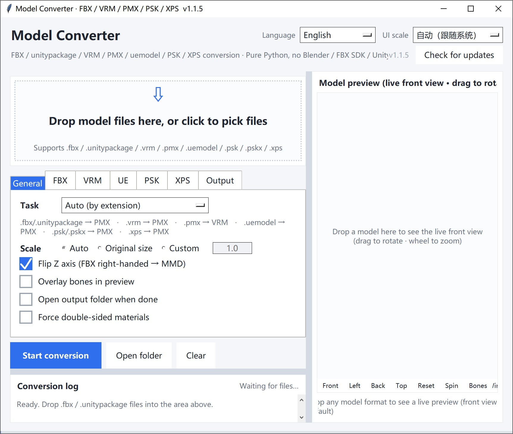

# Model Converter (Pure Python)

> **Model-To-VRM** — a VRM-focused fork of [SaraKale/Model-To-PMX](https://github.com/SaraKale/Model-To-PMX)
> (GPL-3.0). Modified since 2026-10: the PMX → VRM converter was reworked (skeleton, morphs, MToon
> materials, SpringBone) and the VRM → PMX / PMX → uemodel / PMX → psk / PMX → FBX outputs were removed.
> Other inputs (FBX, uemodel, psk, xps) still convert to PMX. The rest of this README describes the
> original multi-format tool and is being updated.
>
> 本项目派生自 SaraKale/Model-To-PMX（GPL-3.0），2026-10 起修改：重做了 PMX → VRM，删除了
> VRM → PMX、PMX → uemodel / psk / FBX 输出；以下内容仍是原项目说明，待更新。
>
> **三维预览**：`python gfx/web_preview.py 模型.vrm`（或界面里的「三维预览（three-vrm）」按钮）用
> three-vrm 显示转换结果——MToon 着色、SpringBone 摆动（待机 / 走路 / 跑步 / 抬腿）、灯光与投影、
> 表情滑块、截图。装了 `pywebview` 时是独立窗口，否则用系统浏览器；页面库在 `gfx/web/vendor/`，离线可用。
> 开发用的批量转换与检查工具见 [tools/README.md](tools/README.md)。

Convert `.fbx`, `.unitypackage`, `.vrm`, `.pmx`, and `.uemodel` (UEFormat) into each other — and `.psk` / `.pskx` (Unreal ActorX) and `.xps` (XNALara / XPS) into PMX — **entirely with the Python standard library**.
No Blender / Autodesk FBX SDK / Unity 3D required, and no plugins such as mmd_tools / UniVRM.
It reads and writes the binary formats directly — just drag a file into the window to convert.

[English](README.md) | [简体中文](README_SC.md) | [繁體中文](README_TC.md) | [日本語](README_JP.md)


---

## Download

Download the latest version from [releases](https://github.com/SaraKale/Model-to-PMX/releases/latest).

## 1. Features

### Supported conversion directions

| Direction | Description |
|---|---|
| FBX / unitypackage → PMX | PMX 2.0 for MMD; quads are auto-fan-triangulated |
| VRM (0.x / 1.0) → PMX | Auto-detects humanoid bones; fills missing ones with placeholder bones |
| PMX → VRM (0.x / 1.0) | Auto-writes VRM meta, humanoid bone mapping, and morph targets |
| uemodel (UEFormat) → PMX | Reads the public UEFormat `.uemodel` (v1–v10); can also write an ASCII FBX in the same run |
| PMX → uemodel (UEFormat) | Writes UEFormat `.uemodel` (v9 by default, v10 optional) for the UE / FModel toolchain |
| PSK / PSKX (Unreal ActorX) → PMX | Reads Unreal `.psk` (`FACE0000`) / `.pskx` (`FACE3200`) with skin weights, MRPH vertex morphs and extra UVs |
| XPS / XNALara → PMX | Reads the XPS "Generic Item 2" binary `.xps` (and the legacy XNALara binary); re-maps axes, renames bones and copies textures over |
| PMX → FBX | Writes ASCII FBX 7.4 (bones, weights, BlendShape morphs, relative texture paths) |
| PMX → psk / pskx | Writes Unreal ActorX format; `.pskx` carries normals / vertex colors / extra UVs / morphs; `.psk` is the standard subset |
| PMX → validation + preview only | Read-only structural validation; no file output |

### Core features

- **Zero external dependencies**: Pure Python standard library (tkinter + ctypes). `Pillow` is an optional accelerator —
  its absence only affects texture-decode speed and some previews, not the main pipeline.
- **Drag & drop, ready to use**: Uses the native Windows `WM_DROPFILES`; you can drop anywhere in the window, with no
  third-party library like tkinterdnd2.
- **Selected-file list**: after dropping, the files (name / format / size) and the total size are listed right under the drop
  area. You can append more, remove single rows, or double-click one row to preview just that file — so **you can see at a
  glance what this batch will convert**, and nothing runs until you click "Start conversion".
- **Real-time front-view preview**: Drag in a model and see the 3D front view immediately; drag to rotate / scroll to zoom,
  and overlay bone points to check alignment (the Front / Left / Back / Top buttons are named after **which side of the model you see**).
- **Never applies Toon**: Every PMX written by every direction uses `toon_flag=0` + `toon=-1`,
  i.e. "no toon" in MMD terms.
- **Multilingual UI**: Switch between Simplified Chinese / Traditional Chinese / English / Japanese in the top-right; the choice is saved to config.
- **HiDPI friendly**: Auto-scales to system DPI; the top-right "UI zoom" lets you set a manual factor.
- **Tabbed options**: The options area is split into seven tabs — General / FBX / VRM / UE / PSK / XPS / Output — for easy extension.
- **Automatic winding-order detection**: Triangle winding is auto-decided by voting between geometric-face normals and vertex normals,
  avoiding large holes / outline lines smearing into black blobs.
- **Texture handling**: PNG/JPEG pass through directly; BMP/TGA are converted to PNG on the fly; embedded in GLB or exported to the PMX directory.
- **PSK / PSKX support**: Reads both `.psk` (`FACE0000`) and `.pskx` (`FACE3200`), carrying over skin weights,
  MRPH vertex morphs and `EXTRAUVS*` extra UV sets. The Bip001 (3ds Max Biped) bone naming is mapped to
  MMD standard Japanese bone names (`センター` / `上半身` / `左足ＩＫ` …) with the **original English name kept in the
  bone's English-name field**, so nothing is lost.
- **XPS / XNALara support**: Reads the XPS "Generic Item 2" binary (magic `323232`, the `XNAaraL` header) as well as the
  legacy XNALara binary, including the variable bone-count-per-vertex introduced in version 3. Axes are re-mapped to MMD's
  (XPS is `+X` left / `+Y` up / `+Z` front, so only Z is negated), bone names like `spine lower` / `arm left elbow` /
  `leg right knee` are turned into MMD standard Japanese names by rule, the `unused …` placeholder bones are moved into a
  separate `unused` display frame instead of being deleted (weights stay intact), and each mesh's diffuse texture is copied
  into `textures/` **with its alpha kept** — in XPS the alpha really is hair / eyelash transparency.
  `.dds` textures are copied as-is: MMD itself supports `.dds`, and the built-in preview decodes DXT1 / DXT3 / DXT5.

---

## 2. Requirements

- **Windows** (drag & drop and the GUI depend on native Windows APIs)
- **Python 3.10+** (3.12 / 3.13 / 3.14 recommended; must ship with tkinter)
- **Optional**: `Pillow` (accelerates texture decoding and preview)

---

## 3. Directory structure

```
Model-to-PMX/
├── main.py                      # ★ GUI entry point (full implementation)
├── main.spec                    # ★ PyInstaller build config
├── config.json                  # UI settings (language / zoom / options, etc.)
├── longpath.py                  # Windows long-path (MAX_PATH 260) compatibility layer
│
├── formats/                     # Format read/write / unpack
│   ├── fbx_reader.py            #   Binary FBX 7.x parser library
│   ├── fbx_probe.py             #   Probe FBX structure (mesh/bones/skinning list)
│   ├── pmxio.py                 #   Full PMX 2.0 read/write (incl. morph/IK/additional/rigidbody/joint)
│   ├── vrmio.py                 #   GLB/glTF container read/write + PNG encode + BMP/TGA/DDS(DXT1/3/5) decode
│   ├── uemodelio.py             #   UEFormat .uemodel read/write (v1–v10)
│   ├── pskio.py                 #   Unreal ActorX .psk / .pskx reader
│   ├── xpsio.py                 #   XPS / XNALara .xps reader (Generic Item 2 + legacy binary)
│   ├── fbxout.py                #   ASCII FBX 7.4 writer (the "also export FBX" option)
│   └── unitypackage_unpack.py   #   Unpack .unitypackage (gzip tar)
│
├── convert/                     # Conversion engine
│   ├── fbx2pmx.py               #   FBX → PMX
│   ├── vrm2pmx.py               #   VRM → PMX
│   ├── pmx2vrm.py               #   PMX → VRM
│   ├── uemodel2pmx.py           #   uemodel (UEFormat) → PMX (+ optional ASCII FBX)
│   ├── pmx2uemodel.py           #   PMX → uemodel (UEFormat)
│   ├── pmx2psk.py               #   PMX → psk / pskx (Unreal ActorX)
│   ├── psk2pmx.py               #   PSK / PSKX (Unreal ActorX) → PMX
│   ├── xps2pmx.py               #   XPS / XNALara → PMX
│   └── pmx_check.py             #   PMX validation + software-rendered preview image
│
├── gfx/
│   └── preview.py               # Real-time 3D front-view preview widget
│
```

> Engine modules are grouped by responsibility into the `formats/` `convert/` `gfx/` sub-directories. At runtime
> `main.py` inserts these three directories into `sys.path`, so modules still use bare-name `import`s (e.g. `import fbx2pmx`).

---

## 4. Usage

### Method 1: Graphical interface (recommended)

1. Run `python main.py`
2. **Drag** a `.fbx` / `.unitypackage` / `.vrm` / `.pmx` / `.uemodel` / `.psk` / `.pskx` / `.xps` file **anywhere into the window**, or click the drop area to choose a file.
   **Dropping only loads the file and shows the preview — nothing is converted automatically.**
   Check the task direction and options, then click "Start conversion" to run.
3. A **selected-file list** (file name / format / size) appears under the drop area, so you can see at a glance what will be converted:
   - dropping again **appends** to the list; duplicates are skipped by absolute path;
   - double-click a row to preview just that file;
   - select rows and click "Remove selected" (or press Delete), or "Clear list" to start over;
   - while the list has files, the drop area shrinks into a thin strip so the list gets the vertical space.
4. The "Task" dropdown can manually specify the conversion direction; by default it is auto-detected from the file extension. Switching the task re-filters the already-loaded files (the list updates too).
5. Conversion log sits at the bottom-left; the model preview is the full-height right column.

UI highlights:

- **Split view**: drag the divider in the middle to resize, just like Blender's areas; the position is saved in `config.json`
- **Full-height preview column**: live front view, with Front / Left / Back / Top / Reset / Spin / Bones / Wire in the toolbar below it.
  The four view buttons are named after **which side of the model you see**: Front = you see the face (camera at `-Z`, which is
  MMD's front), Back = you see the back (camera at `+Z`), Left = you see the model's left side (camera at `+X`; in MMD `+X` is
  the model's left hand side), Top = looking down from above
- **Render backend badge (bottom-right of the preview)**: shows whether `Pillow` or pure Python is in use, plus the last frame time in ms
- **"Language" (top-right)**: Simplified Chinese / Traditional Chinese / English / Japanese (the preview toolbar follows too)
- **"UI zoom" (top-right)**: Auto-follows system DPI, or set a manual factor
- **Option tabs**: General / FBX / VRM / UE / PSK / XPS / Output, seven tabs
- **XPS tab**: bone renaming to MMD Japanese names, adding the leg IK bones, making materials two-sided by default, parking the `unused` placeholder bones into their own display frame, and "also export an FBX"
- **UE tab**: when the `.uemodel` → PMX task is selected, tick "also export an FBX file" to get an ASCII FBX next to the PMX; the same tab sets target height (cm) and alpha handling
- **FBX tab**: three settings; changing them updates both the preview and the "Start conversion" result immediately
  - **Texture alpha channel**: `Keep` (as-is) / `Auto (recommended)` / `Strip all`.
    MMD treats texture alpha directly as material opacity, while game textures often abuse alpha as an emissive or specular mask.
    Those masks must be stripped, otherwise the model turns half-transparent or shows ghost artifacts; real transparency must be kept, otherwise lace, veils and hair tips get clipped into hard edges.
    `Auto` samples only the UV area the texture actually uses (up to 4000 points) and asks whether "almost-fully-transparent ≥ 75% **and** opaque ≤ 5%", cross-checked against whole-image statistics.
    Only when both agree is it treated as a mask — then a copy named `<name>_noalpha.png` is written and **the material is repointed at the copy; the original texture file is never modified**.
  - **Auto-detect facing**: FBX has no "which way does the model face" field. The handedness conversion needs a single-axis reflection, and which axis you reflect decides whether the model ends up facing or facing away from the camera.
    With this on it tries **toe direction** (sum of toe bone offsets relative to their parents, only counted when `|x| << |z|`), then falls back to **face mesh centroid** (weighted centre of face / head / eye / mouth / brow meshes versus the whole-body centre). The verdict and the evidence both go into the log.
  - (Always on) **Meshes with no material attached are skipped**. Game exports (Unity / HoYo style) often carry a sheet named `EffectMesh`: no material node, no texture, UVs spread over the whole atlas, geometry a thin plate spanning the body. Exported as a normal mesh it becomes an opaque grey slab lying on top of the dress — which looks exactly like "the texture got flipped", when in fact the UVs are fine and only the base color is covered up. The log prints `skip <mesh> tris=<n> (no material / effect sheet)`.
  - **Force extra 180° turn**: adds another 180° around Y on top of the detected result. Use it only when auto-detection finds nothing (both heuristics unavailable) or when you genuinely want the model facing away.
- **Textures in the exported FBX**: the written FBX **flips the UV V axis** (PMX/MMD put the UV origin top-left, FBX / Blender / Maya bottom-left) and references textures as a relative path `textures/…`. Keep the FBX next to the PMX together with its `textures` folder — otherwise the shape looks right but the patterns are shifted all over
- **Enlarged checkboxes**: The checkboxes and click areas are easier to hit

### Why the preview stays smooth on heavy models

The live preview is a pure-Python software rasterizer (no OpenGL), so it works in three layers:

1. **Decimated mesh while dragging** — interactively renders ~12k triangles, so a
   90k-triangle model costs about 40 ms per frame;
2. **Sliced refinement after you stop** — the refined frame advances 1500 triangles
   per slice, capped at 24 ms per time slice, so the picture sharpens piece by piece
   without freezing the UI;
3. **Adaptive pixel budget** — resolution scales with the measured frame time, and
   Pillow (when installed) upscales the low-res result to canvas size in C.

### Method 2: Command line

> Always wrap paths containing spaces or non-ASCII characters in double quotes; engine scripts live in the `convert/` `formats/` sub-directories.

```powershell
# Open the GUI
python main.py

# FBX → PMX
python convert/fbx2pmx.py "model.fbx" -o "model.pmx"

# FBX → PMX: pick the alpha mode / disable facing detection / force another 180°
python convert/fbx2pmx.py "model.fbx" -o "model.pmx" --alpha auto
python convert/fbx2pmx.py "model.fbx" -o "model.pmx" --alpha strip
python convert/fbx2pmx.py "model.fbx" -o "model.pmx" --no-auto-facing --face-180

# Unpack a unitypackage (--list lists contents without unpacking)
python formats/unitypackage_unpack.py "pack.unitypackage" --list
python formats/unitypackage_unpack.py "pack.unitypackage"

# Probe FBX structure
python formats/fbx_probe.py "model.fbx"

# PMX → VRM 1.0 (default) / 0.x
python convert/pmx2vrm.py "model.pmx" -o "model.vrm"
python convert/pmx2vrm.py "model.pmx" --spec 0x --title "Name" --author "Author"

# VRM → PMX (textures auto-exported to the PMX directory)
python convert/vrm2pmx.py "model.vrm" -o "model.pmx"

# uemodel (UEFormat) → PMX; add --fbx to also write an ASCII FBX next to the PMX
python convert/uemodel2pmx.py "model.uemodel" -o "model.pmx"
python convert/uemodel2pmx.py "model.uemodel" -o "model.pmx" --fbx

# PMX → uemodel (UEFormat v9 by default; --version 10 for the newer layout)
python convert/pmx2uemodel.py "model.pmx" -o "model.uemodel"
python convert/pmx2uemodel.py "model.pmx" -o "model.uemodel" --version 10

# PSK / PSKX (Unreal ActorX) → PMX
# Bone names become MMD standard Japanese names by default (originals go to the English-name field);
# textures are looked up by material name in the source folder
python convert/psk2pmx.py "model.psk" -o "model.pmx"
python convert/psk2pmx.py "model.pskx" -o "model.pmx" --raw-bone-names --no-ik

# XPS / XNALara → PMX
# Axes are re-mapped and bone names become MMD standard Japanese names by default
# (originals go to the English-name field); the per-mesh diffuse texture is copied into textures/
python convert/xps2pmx.py "model.xps" -o "model.pmx"
python convert/xps2pmx.py "model.xps" -o "model.pmx" --raw-bone-names --no-ik
python convert/xps2pmx.py "model.xps" -o "model.pmx" --show-unused --one-sided
python convert/xps2pmx.py "model.xps" -o "model.pmx" --fbx

# PMX → FBX (ASCII 7.4, with bones/weights/BlendShapes/relative texture paths)
python convert/fbxout.py "model.pmx" -o "model.fbx"

# PMX → pskx (default pskx, with normals/extra UVs/morphs; default target height 160 cm)
python convert/pmx2psk.py "model.pmx" -o "model.pskx"

# PMX → psk (standard chunks only, no normals/morphs)
python convert/pmx2psk.py "model.pmx" -o "model.psk" --std

# PMX validation + generate preview image
python convert/pmx_check.py "model.pmx"
python convert/pmx_check.py "model.pmx" --bones   # overlay bone positions

# Change a PMX's text encoding to UTF-16LE (fix for files from older builds)
python formats/pmxio.py "model.pmx"               # writes model_utf16.pmx
python formats/pmxio.py "model.pmx" --in-place    # overwrite (back up first)
```

#### Common options quick reference

`fbx2pmx.py`:

| Option | Description |
|---|---|
| `--scale mmd` | Default; auto-scale to MMD standard height (≈ 20 units) |
| `--scale raw` | Keep FBX's original size (meters) |
| `--scale 12.5` | Manually specify a scale factor |
| `--no-flip-z` | Skip right-handed → left-handed conversion (on by default) |
| `--alpha keep\|auto\|strip` | Texture alpha handling, default `auto` (see below) |
| `--remove-alpha` | Legacy switch, equivalent to `--alpha auto` |
| `--no-auto-facing` | Disable facing auto-detection, use the default single-axis reflection (Z) |
| `--face-180` | Force an extra 180° turn on top of the detected result |
| `--keep-untextured-meshes` | Keep meshes that carry no material (skipped by default, see "effect sheet" below) |
| `--info` | Only print structure info, no conversion |

What the three `--alpha` modes do:

| Mode | Behaviour |
|---|---|
| `keep` | Leave alpha alone; reference the original texture files directly |
| `auto` (default) | Judge per texture: only ones classified as a mask get an alpha-free copy `<name>_noalpha.png` and a repointed material; genuinely translucent or fully opaque ones are kept as-is |
| `strip` | Strip alpha from anything that has an alpha channel (the old behaviour) |

Detection thresholds (identical to the `PEPlugins-FBXimport` plug-in): alpha < 8 counts as transparent, > 250 as opaque;
the UV-area sampling (up to 4000 points) and whole-image statistics must corroborate each other, and **transparent ≥ 75% with opaque ≤ 5%** is required to call it a mask.
With no usable UV it falls back to 90% / 1% over the whole image. Per-texture verdicts (name → strip / keep plus the transparent and opaque ratios) are written to the log.

`pmx2vrm.py`: `--spec 1.0|0x`, `--scale auto|factor`, `--rotate auto|none|y180`,
`--flip-winding`, `--force-double-sided`, `--keep-pose` (keep the A-pose instead of the default T-pose),
`--outline` (MToon outlines from the PMX edge settings), `--dense-morphs` (dense instead of sparse morph targets),
`--no-spring` / `--no-spring-skirt` / `--spring-stiffness k` / `--spring-gravity g` / `--spring-gravity-skirt g` / `--no-spring-center` (PMX physics → VRM 1.0 SpringBone, on by default),
`--max-morphs N`, `--title` / `--author`.

`vrm2pmx.py`: `--scale`, `--rotate`, `--flip-winding`, `--edge` (enable outline),
`--force-double-sided`, `--name`.

`psk2pmx.py`:

| Option | Description |
|---|---|
| `--scale mmd` | Default; normalizes height to MMD's standard 20 units via the bounding box |
| `--scale 0.14` | Manual scale factor |
| `--edge` | Enable MMD outline on materials (off by default) |
| `--force-double-sided` | Force two-sided drawing (common for thin hair / skirts) |
| `--no-textures` | Don't look for textures; export an untextured model |
| `--keep-alpha` | Keep texture alpha (by default alpha is stripped per material) |
| `--no-add-uv` | Drop `EXTRAUVS*` extra UV sets |
| `--raw-bone-names` | Keep the original English bone names (default: convert to MMD Japanese names, originals kept in the English-name field) |
| `--no-ik` | Don't add MMD leg IK bones (default: add `左足ＩＫ` / `左つま先ＩＫ` when the leg chain is complete) |
| `--no-morphs` | Don't export morphs (default: convert MRPH vertex offsets into PMX vertex morphs) |
| `--fbx` | Also write an ASCII FBX next to the PMX |
| `--name` | Model name |

For more detailed options and format mappings, see `FBX转PMX_使用说明.md` and `VRM互转_使用说明.md`.

---

## 5. Build & packaging

### 1. Install PyInstaller

```powershell
pip install pyinstaller
pip install pillow          # optional; makes the bundled build also get the texture-speedup
```

### 2. Build with the spec (recommended)

> **Always use the spec**; do not run `pyinstaller main.py` directly.

```powershell
pyinstaller main.spec
```

Output: `dist/ModelConvert.exe/ModelConvert.exe` (one-folder mode).

### 3. Why the spec is mandatory

Engine modules are placed in the `formats/` `convert/` `gfx/` sub-directories, and `main.py` uses bare-name
imports like `import fbx2pmx`. The sub-directories are only added at **runtime** via `sys.path.insert`.
**PyInstaller only does static analysis and cannot see the runtime path injection** — if those sub-directories
are absent from `pathex`, the build stage silently drops them as "missing modules". The build succeeds, but at
runtime it throws:

```
ModuleNotFoundError: No module named 'fbx2pmx'
```

`main.spec` already configures this correctly:

```python
Analysis(
    ['main.py'],
    pathex=['.', 'formats', 'convert', 'gfx'],     # let static analysis find the sub-dir modules
    hiddenimports=['fbx2pmx', 'pmx_check', 'pmx2vrm', 'vrm2pmx', 'preview',
                   'unitypackage_unpack', 'fbx_reader', 'pmxio', 'vrmio'],
    ...
)
```

If you don't want to use the spec, the equivalent command is:

```powershell
pyinstaller --paths formats --paths convert --paths gfx -w main.py
```

### 4. Common options

| Option | Description |
|---|---|
| `-F` | Build into a single executable |
| `-D` | Build into a folder containing multiple files (default) |
| `-w` | Hide the console window (GUI app) |
| `-i icon.ico` | Specify the executable icon |
| `-n name` | Specify the generated executable name |
| `--add-data "src:dst"` | Add resource files |
| `--hidden-import module` | Manually add a hidden dependency |

### 5. Automated release (GitHub Actions)

[`.github/workflows/build-app.yml`](.github/workflows/build-app.yml) builds the app on six targets —
Windows x64 / ARM, macOS Intel / ARM, Linux x64 / ARM — and attaches every build to a GitHub
Release. You do **not** need to build locally to publish a version.

The workflow fires when you push a version tag (the tag must look like `v1.2.3`):

```bash
git add .
git commit -m "Release v1.0.0"
git tag v1.0.0
git push origin v1.0.0
```

It then:

1. runs `pyinstaller main.spec` on all six runners;
2. zips each build as `ModelConvert-<tag>-<platform>.zip`;
3. creates the GitHub Release for that tag and uploads the six zips.

The Release is created as a **draft** — open the Releases page, check the files, then publish it.

You can also run it by hand: **Actions → Build ModelConvert → Run workflow**, and put an existing
tag in the `release_tag` field to (re)upload the artifacts to that Release.

---

## 6. Notes

### General

1. **Paths with spaces / non-ASCII**: Always wrap them in double quotes on the command line.
2. **Settings file `config.json`**: Stores language, UI zoom, task direction, and each option; it is recreated with defaults if deleted.
3. **Shortcuts & interaction**: The preview area supports drag-to-rotate and scroll-to-zoom; clicking the drop area opens a file picker.

### Error `FileNotFoundError: [Errno 2]` (path too long)

- Windows limits a path to 260 characters (MAX_PATH) by default. A Unity package unpacks into a deep folder tree, and stacking "output dir / name_date_001 / name_extracted" on top of it overflows easily.
  The path in the error message looks perfectly normal — it is simply **too long**. Telltale sign: it works from a shallow folder but fails from something like `F:\xxx\yyy\zzz\` on the same machine.
- **Handled automatically**: over-long paths are switched to the Windows extended-length form (`\\?\`). No registry edit, no admin rights, no reboot.
- On an older build, please update; as a stopgap, copy the `.unitypackage` near a drive root (e.g. `D:\conv\`) and convert there.
- This is **not** a non-ASCII path problem: Chinese, Japanese, spaces and brackets are all fine on their own — only the total length matters.

### Model all-black / black outline / holes

- **Black lines on model edges after conversion**: The converter now disables the MMD outline by default (vertex edge=0, material edge_size=0, edge_color alpha=0). If you still see black edges, open the model in MMD / PMXEditor, make sure the **outline is turned off** for all materials, and check **"Double-sided drawing"**.
- **Still has holes**: First look at the `绕序自动判定` (auto winding-order detection) line in the log. If it's wrong, add `--flip-winding`; if thin geometry (hair / skirt) relies on double-sided rendering, add `--force-double-sided`, or check "Force double-sided materials" in the UI.

### Model facing away / wrong direction

- FBX stores no "which way is forward" field, so no heuristic is right 100% of the time. Keep **"Auto-detect facing"** on (default) in the FBX tab and the converter tries **toe direction** first, then **face mesh centroid**, writing both the verdict and the evidence to the log (`自动判定朝向：面朝 +Z（依据：脚尖）`).
- When neither heuristic yields anything (non-standard bone names and no recognizable face mesh) it falls back to the default reflection. If the model then **faces away from the camera** in MMD, tick **"Force extra 180° turn"** (`--face-180`): it just negates X and Z together (half a turn around Y), leaving vertex / face / bone counts and the winding-order detection untouched.
- If the verdict itself is wrong, disable it with `--no-auto-facing` and dial it in manually with `--face-180` — the equivalent of `AutoDetectFacing=false` + `Rot180Y=true` in the plug-in.
- **PSK / PSKX is not affected by any of this**: the Unreal PSK format has a well-defined axis convention
  (`-Y` is the front), so the axis swap is a fixed single reflection and needs no detection. If a PSK you have
  comes out facing away, its source convention differs from the norm — rotate it 180° around Y in PMXEditor.
- **XPS / XNALara is not affected either**: XPS is "`+X` left, `+Y` up, `+Z` front", so the axis swap is again a
  fixed single reflection (`(x, y, z) → (x, y, -z)`). If an `.xps` comes out facing away, it was authored in a
  different convention — rotate it 180° around Y in PMXEditor.

### Transparent where it shouldn't be / opaque where it should be

- **Whole model half-transparent, ghost artifacts**: the texture almost certainly uses alpha as an emissive / specular mask. Use `--alpha strip` ("Strip all" in the UI); day to day leave it on `auto`, which judges each texture and only processes the ones classified as masks.
- **Lace / veils / hair tips clipped into hard edges**: real transparency got stripped — switch back to `auto` or pick `keep`.
- In every mode **the source texture file itself is never modified**: the stripped result goes to a `<name>_noalpha.png` copy and only the material reference is repointed.
- The `贴图透明通道` block in the log lists every texture as "name → strip / keep (transparent x%, opaque y%)" — read that when you're unsure.

### A grey slab covers the model / looks like "the UVs got flipped"

- Don't reach for the UVs yet. Game FBX files (Unity / HoYo style) often contain an `EffectMesh` with **no material node and no texture**, UVs spread across the whole atlas, geometry a thin plate spanning the body. Exported as an ordinary mesh it becomes an opaque grey slab sitting right on top of the skirt — visually almost identical to "the texture is flipped vertically", but the UVs are actually correct.
- The converter **skips every mesh that has no material** by default, and logs `skip <mesh> tris=<n> (no material / effect sheet)`. Check the log for that line to confirm.
- If you do need such a mesh, pass `--keep-untextured-meshes` (there is no UI toggle for it; command line only).

### Known limitations

- **FBX structure**: both binary FBX 7.x and ASCII FBX are read (the older "ASCII is not supported" note was wrong).
- **Texture formats**: `.dds` is decoded natively (DXT1 / DXT3 / DXT5) — the built-in preview shows it, and it is copied
  as-is on the XPS / PSK paths because MMD itself reads `.dds`. KTX2 / WebP are still not decoded, so they degrade to a solid colour.
- **Physics**: PMX → VRM **1.0** converts rigid bodies/joints to SpringBone (an approximation tuned to behave like native VRM models, not a replica of MMD's Bullet physics); VRM 0.x output and the reverse direction (VRM SpringBone → PMX rigid bodies) are not converted.
- **Material effects**: Spherical maps (.sph/.spa) and toon maps are not preserved on the VRM side; in the other direction (→ PMX) this tool never applies toon.
- **Bone names**: FBX conversion keeps English bone names (`Hips`, `Spine` …), so they won't match MMD's ready-made motions (.vmd); you must batch-rename them to the Japanese standard names in PMXEditor.
  PSK takes a different route: the Bip001 (3ds Max Biped) naming is **converted to MMD standard Japanese names by default**, with the original English name kept in the bone's English-name field.
  XPS does the same: `spine lower` / `arm left elbow` / `leg right knee` / `arm left finger 2b` … are renamed by rule
  (`上半身` / `左ひじ` / `右ひざ` / `左人指２` …), and anything unrecognised keeps its original name.
- **Morphs**: When the source model has no BlendShape / morph, the PMX morphs are also 0 and must be created by hand.
- **PSK axes are a fixed mapping**: Unreal's PSK is "`+X` left hand, `-Y` front, `+Z` up" while PMX is
  "`+X` left hand, `-Z` front, `+Y` up" — opposite handedness, so the axis swap must include **one reflection**
  (`(x, y, z) → (x, z, y)`). This is hard-coded; there is no "auto-detect facing" switch like FBX has.
- **PSK / PSKX round-trip caveats**:
  - PMX→psk bone names fall back to `name_en`; if that is empty, a JP→EN lookup table is used
    (`全ての親` → `Root`, `センター` → `Center`, etc.); otherwise they become `bone%03d`.
  - PMX IK / inherit / rigidbody / joint / UV-morph / material-morph have no PSK equivalent and are skipped.
  - PMX allows at most 4 bones per vertex; if the original PSK has 5–6, they are lost on round-trip.
- **The `.psk` extension collides**: PmxEditor stores its "anchor data" in `.psk` files, the same extension Unreal meshes use.
  See "PmxEditor reports アンカーデータの読み込みに失敗しました" below.
- **XPS / XNALara**: only the **binary** `.xps` is read (both the XPS "Generic Item 2" variant and the legacy XNALara binary).
  The old **ASCII** `.xps` / `.mesh.ascii` text variant is not supported — it errors out with a clear message instead of
  producing a broken model. The 129 bytes of trailing data after the last mesh are ignored (they carry no model data).
- **XPS has no morphs**: the format stores no blend shapes, so the exported PMX has 0 morphs and you add expressions
  (blink / mouth shapes) by hand in PMXEditor. XPS *does* ship per-vertex colours; they are currently not written to PMX.

### MMD says it cannot load the model (text encoding)

MMD **only accepts PMX files whose text encoding is UTF-16LE**. The original message is
`MMDではエンコード方式がUTF16のPMXファイルしか読み込めません`
(English string in the same binary: `MMD can't read UTF8 encorded PMX. Please exchange it to UTF16.`).
The Chinese localizations render it as "MMD 不能载入编码为 UTF16 的 PMX 文件", which is a
**mistranslation that reverses the meaning** — seeing it means the file was saved as UTF-8.

This tool always writes UTF-16LE. Files exported by older builds can be fixed with
`python formats/pmxio.py "old.pmx"`; the validation log also reports
`文本编码是 UTF-8，MMD 无法载入（需要 UTF-16LE）`.

### PmxEditor reports "アンカーデータの読み込みに失敗しました。" (the model still shows up after you click OK)

**This is not an MMD error — it comes from PmxEditor**, and it has nothing to do with the PMX file itself.

PmxEditor has an "anchor" (アンカー) feature for assigning bone-to-vertex weights in bulk over a spatial region.
Its data **cannot be stored inside a PMX**; it is saved separately as a `*.psk` file (PmxEditor calls it a
"PMX skeleton"). When opening a model, PmxEditor looks for the `.psk` **with the same base name as the model**
and loads it automatically — see its menu `[ファイル] → [アンカーデータの自動読み込み／保存]`. From its readme:

> `[アンカーデータの自動読み込み／保存]` - モデルファイル名と同名のアンカーデータファイル(\*.psk)がある場合自動読み込み

The catch: **`.psk` is also the extension of Unreal ActorX meshes**, which is exactly what this tool reads.
So the most natural naming — converting `R2T1FeiBiMd10011.psk` into `R2T1FeiBiMd10011.pmx` — makes PmxEditor
try to parse that Unreal mesh as its anchor data, which of course fails and raises this message.

**Impact: none.** After clicking OK, PmxEditor simply skips the anchor data and the model loads normally.
To stop the popup entirely:

1. Move the output PMX to another folder, or rename it (anything but `xxx.pmx` next to `xxx.psk`); or
2. Turn off `[ファイル] → [アンカーデータの自動読み込み／保存]` in PmxEditor.

When a same-named `.psk` / `.pskx` sits next to the output PMX, this tool says so in the log.

### About Toon

Every PMX this tool writes, in every direction, **does not use Toon**: materials are written as
`toon_flag=0` + `toon=-1`, which PMXEditor / MMD show as "なし" (none).

⚠️ One easy-to-get-wrong detail worth recording: the width of a PMX material's toon field depends on the
"shared toon flag" byte, and the two directions are easy to swap:

| flag | Meaning | Field |
|---|---|---|
| `1` | Shared / built-in toon | **1 byte index** referring to `toon01.bmp` … `toon10.bmp` in MMD's `Data/` folder — **index 0 *is* `toon01.bmp`** |
| `0` | A texture from this model's texture table | Texture-index width, where **`-1` = none** |

"Index 0 = `toon00.bmp` = no toon" is a widespread misconception — **MMD's `Data/` folder contains no
`toon00.bmp` at all** (only `toon01` … `toon10`), and mmd_tools hard-codes `toon%02d.bmp % (shared + 1)`.
So writing `flag=1, toon=0` actually forces a `toon01.bmp` onto every material. Versions of this tool
before 2026-09-24 did exactly that; it is now fixed to `flag=0, toon=-1`.

### Drag & drop

- Drag & drop relies on the native Windows `WM_DROPFILES` and is **only available on Windows**; on other systems use the "Browse" button to pick a file.
- If the log says "system drag-drop interface not enabled", the current environment does not support native drag & drop; just use the button instead.

### Packaging

1. **You must use `pyinstaller main.spec`** (or the equivalent command with `--paths`), otherwise the engine modules in the sub-directories are left out and runtime throws `No module named 'fbx2pmx'`.
1. **After editing source you must rebuild**; double-clicking the old .exe will not pick up changes.
2. The Python used for packaging must include tkinter (the official Windows installer includes it by default).

---

## 7. Copyright reminder

The VRM meta carries license information. This tool writes the most conservative default: "Attribution required, redistribution prohibited, modification prohibited".

**Confirm you have the right to use the model before converting** — the tool will not perform a copyright check for you.
