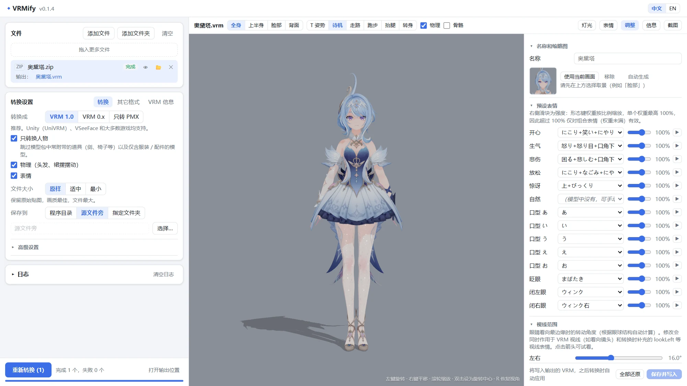
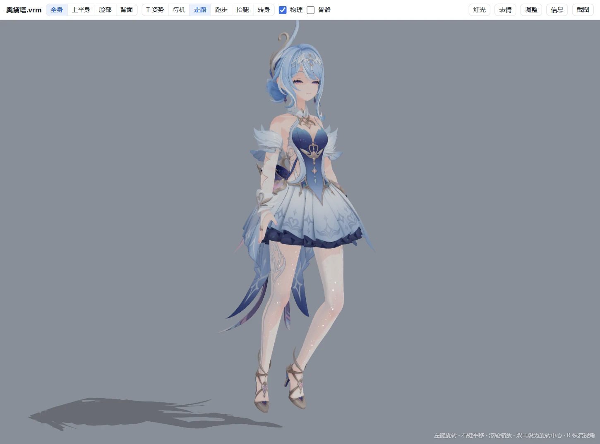
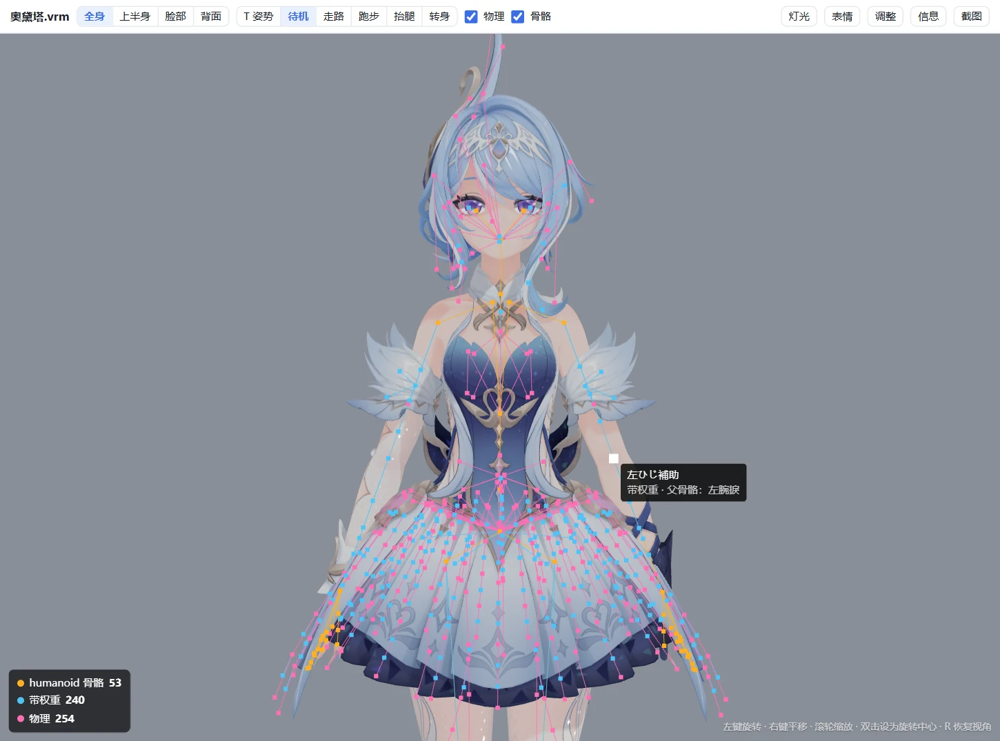
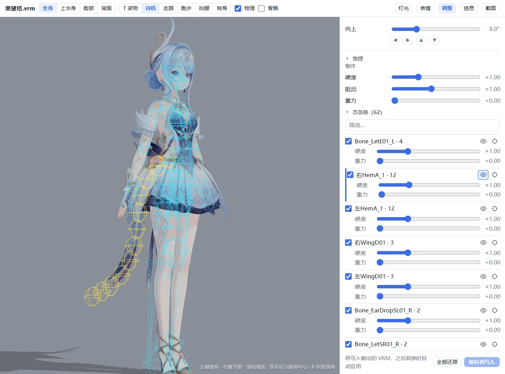
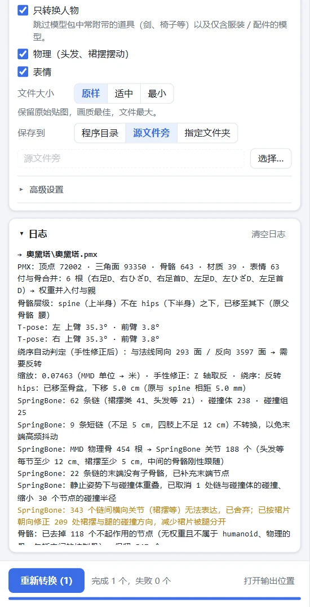

<p align="center">
  
</p>

<h1 align="center">VRMify</h1>

<p align="center">
  把 MMD / PMX 模型（以及 FBX、unitypackage、Unreal、XNALara 模型）转成 VRM 虚拟形象。<br>
  拖入文件或整个压缩包，预览确认，就完成了。不需要 Blender、Unity 或任何插件。
</p>

<p align="center">
  <a href="https://github.com/JiGuang283/VRMify/releases/latest"></a>
  
  
  <a href="LICENSE"></a>
</p>

<p align="center">
  <a href="README.md">English</a> | 简体中文
</p>

<p align="center">
  
</p>

## 亮点

- **一个窗口，不用安装。** Windows 绿色版 exe，转换器本身是纯 Python，不需要配置 Blender、Unity 或插件。
- **转出来就好看。** 按 PMX 的 toon 贴图生成 MToon 卡通着色，透明按贴图逐张判定，A-pose 自动抬成 T-pose，
  情绪表情像 VRoid 一样眉、眼、嘴一起变。
- **物理手感接近原生 VRM。** PMX 刚体换算成 VRM 1.0 SpringBone 链和碰撞体，裙摆做了专门处理；
  没有物理的模型按骨骼名自动补头发、裙摆、飘带。
- **干净的骨架。** MMD、VRChat、Mixamo、Unity 的骨名都能对应 VRM humanoid；付与骨合并，IK、末端骨、
  控制骨这类在 VRM 里不起作用的骨去掉，层级和 VRoid 一样。
- **模型网站下载的包直接用。** zip / 7z / rar 原样拖进来，自动找出里面的模型，跳过道具和只有衣服的模型，
  老 zip 包里乱码的日文 / 中文文件名也能还原。
- **用之前先看。** three-vrm 预览（和 UniVRM 同一套规则），可以播放走路、跑步动作、试表情，叠加显示骨骼和
  碰撞体。预设表情、物理、视线范围、缩略图都能直接调，不用重新转换。
- **输出可靠。** 通过 VRM 官方 JSON Schema 校验，避开会让 UniVRM 导入失败的数据。

## 截图

<table>
  <tr>
    <td width="50%"></td>
    <td width="50%"></td>
  </tr>
  <tr>
    <td><b>预览</b>：待机、走路、跑步动作，灯光，表情</td>
    <td><b>骨骼显示</b>：humanoid、带权重、物理骨分色，悬停显示骨名和父骨</td>
  </tr>
  <tr>
    <td colspan="2" align="center">
      
      
    </td>
  </tr>
  <tr>
    <td colspan="2"><b>调整</b>：预设表情、视线、逐条链的物理，并显示这条链和它的碰撞体 ·
      <b>日志</b>：转换了什么、合并或跳过了什么，一目了然</td>
  </tr>
</table>

<sub>截图中的模型：奥黛塔（模型提供 miHoYo，改造 观海），按其使用条款展示。</sub>

## 快速开始

1. 到 [Releases](https://github.com/JiGuang283/VRMify/releases/latest) 下载 `VRMify-v<版本>-win64.zip`，
   解压后运行 `VRMify.exe`。
2. 把模型文件、文件夹或压缩包拖进窗口，点「开始转换」。
3. 点文件旁的眼睛图标预览 VRM，需要的话在「调整」里修改。

> [!NOTE]
> 程序没有代码签名，第一次运行时 Windows 可能提示「已保护你的电脑」：点「更多信息 → 仍要运行」。
> 窗口使用系统的 WebView2（Windows 11 自带，Windows 10 基本都有）；没有时会改用浏览器打开界面。

## 支持的格式

| 输入 | |
|---|---|
| **PMX**（MMD） | 主要路径：骨骼、材质、表情、物理全部转换 |
| **FBX**、**unitypackage** | Unity / VRChat 风格的模型，自动判定朝向和贴图透明 |
| **uemodel**（UEFormat）、**psk / pskx**（Unreal ActorX） | Unreal 模型；uemodel 部件可以按整身参考对齐 |
| **xps**（XNALara） | |
| **zip / 7z / rar** | 找出里面的模型并转换；7z / rar 借用 7-Zip、WinRAR、Bandizip 或 Windows 自带的 `tar` |
| **VRM** | 在预览和「调整」里打开 |

输出：**VRM 1.0**（带 SpringBone 物理）、**VRM 0.x**（不含物理），或只转到 **PMX**。

## 转换时做了什么

<details>
<summary><b>骨骼</b></summary>

- MMD 标准骨名（以及常见的英文、VRChat、Mixamo、Unity 骨名）对应 VRM humanoid；缺少的必需骨位补占位骨，
  保证层级合法。
- 足D 这类付与骨连同权重并入它跟随的骨。
- 在 VRM 里不起作用的骨（IK、末端骨、操作中心）去掉。「精简控制骨」（默认开）再去掉センター、グルーブ 这类
  没有权重的中间骨，层级是 Root > Hips。蒙皮和动作不受影响。
- A-pose 的手臂抬成 VRM 要求的 T-pose，hips 移到骨盆。
</details>

<details>
<summary><b>材质</b></summary>

- MToon 着色：阴影色和明暗交界从 PMX 的 toon 贴图换算。
- 不透明、裁剪、半透明按贴图本身判定；材质名保证不重复。
- 可选贴图瘦身（缩小尺寸、不透明贴图存 JPEG），文件通常能小一半。
</details>

<details>
<summary><b>表情</b></summary>

- 眨眼和口型（aa / ih / ou / ee / oh）按 MMD、VRoid、VRChat、ARKit 和常见中文表情名对应。
- 情绪预设（开心、生气、悲伤、放松、惊讶）像 VRoid 一样组合眉、眼、嘴。
- 材质表情、骨骼表情、UV 表情都会转换；有眼骨时补视线表情。
- 补充固定名字的 `hideHighlight`（关掉眼睛高光）和 `tongue`（吐舌）：优先用模型自带的表情，没有关闭高光的
  表情时按眼睛高光材质生成。
</details>

<details>
<summary><b>物理</b></summary>

- PMX 的刚体和关节换算成 VRM 1.0 SpringBone 的链、碰撞体和碰撞组。
- 裙摆链的碰撞体会调整位置，被腿推开时整片一起动，不会从中间劈开；手臂、腿上很短的链跟着骨骼刚性移动，
  避免抖动。
- 没有刚体的模型（FBX 等）按骨骼名自动补头发、裙摆、袖子、飘带、尾巴的链。
</details>

更多细节和全部选项：[PMX → VRM](docs/pmx-to-vrm.md)、[其它格式 → PMX](docs/other-formats.md)。

## 使用

**设置**分三页：「转换」（目标格式、只转换人物、物理、表情、文件大小、保存位置，更多选项在「高级设置」里）、
「其它格式」（FBX / uemodel / psk / xps 的选项）、「VRM 信息」（写进每个 VRM 的作者、版本和使用许可，
默认是最保守的授权）。

**预览操作**

| | |
|---|---|
| 左键拖动 / 右键拖动 / 滚轮 | 旋转 / 平移 / 朝鼠标位置缩放 |
| 双击模型 | 以这一点为中心旋转 |
| `R` 或 `Home`，或双击空白处 | 回到当前选中的视角 |
| 「骨骼」开关 | 叠加显示骨骼；悬停显示骨名和父骨 |

**调整**不用重新转换就能修改：名称和缩略图、每个预设对应哪个表情和强度、视线范围、整体或逐条链的物理硬度和
重力。鼠标移到某条链上会显示这条链和它会碰到的碰撞体，也可以固定显示或让镜头对准它。修改直接写进 VRM，
下次再转同一个文件会自动套用。

每次转换后会自动截取脸部作为缩略图（可关闭；自己设置的缩略图不会被覆盖）。

## 命令行

```bash
python convert/pmx2vrm.py "model.pmx" -o "model.vrm"     # VRM 1.0
python convert/pmx2vrm.py "model.pmx" --spec 0x          # VRM 0.x
python convert/fbx2pmx.py "model.fbx" -o "model.pmx"     # 其它格式 → PMX，再转 VRM
python tools/qa/check_vrm.py "model.vrm"                 # 检查 VRM（结构 + 官方 Schema）
```

## 常见问题

<details>
<summary><b>Unity 或游戏导入时卡住</b></summary>

多半是 UniVRM 遇到了不合规的数据。用 `python tools/qa/check_vrm.py 文件.vrm` 检查；Unity 程序的日志在
`%USERPROFILE%\AppData\LocalLow\<公司>\<产品>\Player.log`，里面有具体的异常。
</details>

<details>
<summary><b>脸看起来很平、没有阴影</b></summary>

VRoid 等原生 VRM 模型的脸本来也基本是平涂，阴影主要来自头发等的投影。阴影颜色来自 PMX 的 toon 贴图，
可以在预览的「灯光」里调角度、开关投影检查。
</details>

<details>
<summary><b>头发、裙摆抖动或穿模</b></summary>

SpringBone 是 MMD 物理的近似。在「调整」里整体或逐条链调硬度和重力；鼠标移到链上可以看到它用了哪些碰撞体。
</details>

<details>
<summary><b>模型有破洞、黑边，或薄片头发看不见</b></summary>

在「转换」页的「高级设置」里打开「所有材质双面」。转换日志里也有三角形绕序的判定结果。
</details>

<details>
<summary><b>FBX 朝向反了或透明不对</b></summary>

在「其它格式」页打开「额外旋转 180°」，或换一种「贴图透明通道」模式。
</details>

## 已知限制

- VRM 0.x 不含物理（SpringBone 只写在 VRM 1.0 里）。
- PMX 里连接相邻裙摆链的横向关节在 SpringBone 里没有对应，裙摆整片联动的效果比 MMD 弱。
- 乘算 sphere 贴图和共享的 toon07～10 在 MToon 里没有对应；描边默认关闭。
- 预设表情按名字对应，名字特殊的模型需要在「调整」里指定。
- XPS 模型没有表情。

## 从源码运行

需要 Python 3.10 或更高版本。

```bash
python -m venv .venv
.venv\Scripts\pip install -r requirements.txt   # 可选：pywebview（独立窗口）、Pillow（贴图处理更快）
python ui/app.py                                # 或双击 VRMify.bat；--browser 用浏览器打开界面
```

不装可选依赖也能转换，只是界面会在浏览器里打开，也不能瘦身贴图。

<details>
<summary><b>目录结构和开发</b></summary>

```
convert/   转换器：pmx2vrm.py（PMX → VRM）及其各阶段 vrmconv/，fbx2pmx / uemodel2pmx / psk2pmx / xps2pmx，
           pipeline.py（界面的转换流程），vrm_edit.py（调整）
formats/   文件格式：pmxio、vrmio（GLB）、fbx_reader、uemodelio、pskio、xpsio、archive
ui/        桌面程序：app.py（入口）、server.py（后端）、web/（页面）、viewer/（three-vrm 预览）
tests/     单元测试（用 synth.py 生成的小模型）
tools/     批量转换、VRM 检查、物理测试、真实模型回归、打包发布
docs/      转换说明
```

```bash
pip install -r requirements-dev.txt           # jsonschema、pyinstaller 等
python -m unittest discover -s tests          # 单元测试
python tools/regress.py record <模型目录>      # 用自己的模型记录基准（不进仓库）
python tools/regress.py check                 # 改代码后重转并对比
python tools/build_release.py                 # → dist/VRMify-v<版本>-win64.zip
```

发版：改 `ui/version.py`，提交，推送 `v<版本>` 标签；GitHub Actions 会测试、打包、冒烟测试 exe 并创建草稿 Release。
</details>

## 参与贡献

欢迎提交问题和 Pull Request。反馈转换问题时请附上转换日志，并说明模型的来源和格式——不要附上你无权分享的
模型文件。提交 Pull Request 前请先跑一遍单元测试。

## 许可

- VRMify 使用 [GPL-3.0](LICENSE) 许可。基于 [SaraKale/Model-To-PMX](https://github.com/SaraKale/Model-To-PMX)。
- 预览使用 [three.js](https://threejs.org/)、[three-vrm](https://github.com/pixiv/three-vrm)（MIT）和
  ammo.js（zlib），见 `ui/viewer/vendor/`。
- **转换前请确认你有权使用这个模型。** 很多 MMD 模型禁止再分发或修改，转换后的 VRM 同样受这些条款约束。
