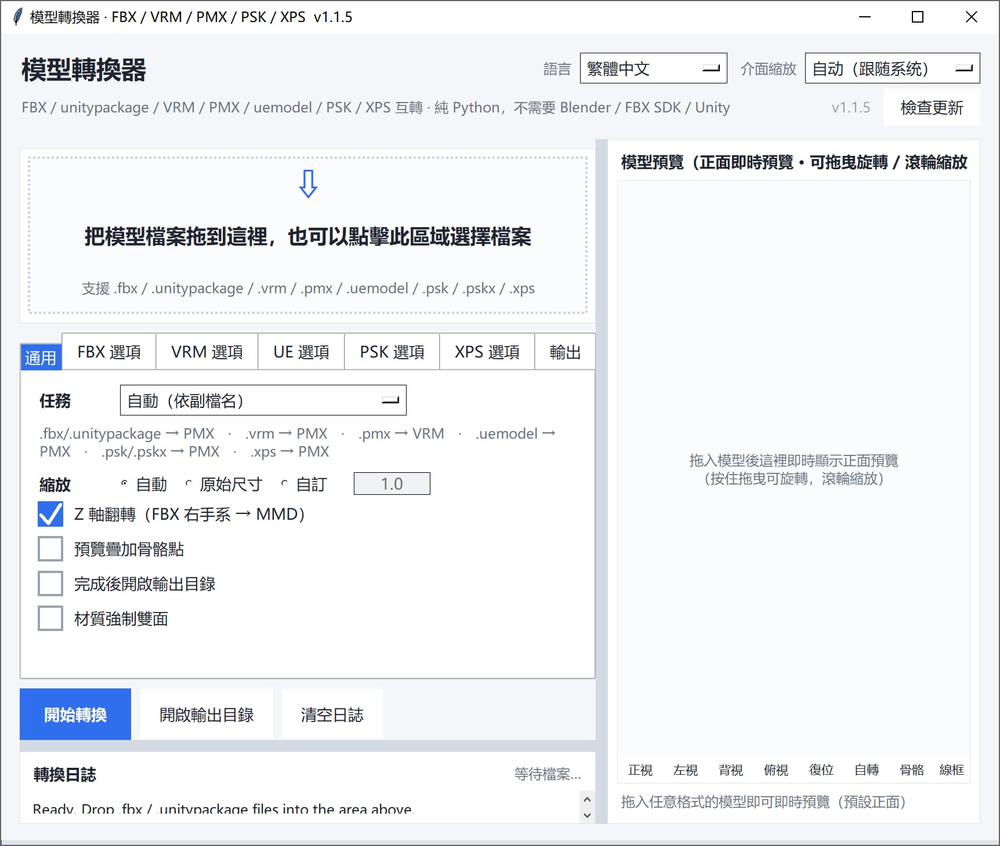

# 模型轉換器（純 Python）

把 `.fbx`、`.unitypackage`、`.vrm`、`.pmx`、`.uemodel`（UEFormat）互相轉換，並能把 `.psk` / `.pskx`（Unreal ActorX）和 `.xps`（XNALara / XPS）轉成 PMX，**全部用 Python 標準庫實作**。
不需要 Blender / Autodesk FBX SDK / Unity 3D，也不需要 mmd_tools / UniVRM 等外掛。直接讀寫二進制格式，拖進視窗即可轉換。

[English](README.md) | [簡體中文](README_SC.md) | [繁體中文](README_TC.md) | [日本語](README_JP.md)


---

## 下載

請從 [releases](https://github.com/SaraKale/Model-to-PMX/releases/latest) 下載最新版本。

## 一、功能特點

### 支援的轉換方向

| 方向 | 說明 |
|---|---|
| FBX / unitypackage → PMX | MMD 用 PMX 2.0，四邊形自動扇形三角化 |
| VRM（0.x / 1.0） → PMX | 自動辨識 humanoid 骨骼，缺的補佔位骨 |
| PMX → VRM（0.x / 1.0） | 自動寫 VRM meta、humanoid 骨骼映射、morph target |
| uemodel（UEFormat） → PMX | 讀公開的 UEFormat `.uemodel`（v1–v10）；可同時匯出一份 ASCII FBX |
| PMX → uemodel（UEFormat） | 寫出 UEFormat `.uemodel`（預設 v9，可選 v10），可交給 UE / FModel 生態 |
| PSK / PSKX（Unreal ActorX） → PMX | 讀 Unreal 的 `.psk`（`FACE0000`）/ `.pskx`（`FACE3200`），帶頂點權重、MRPH 頂點表情、附加 UV |
| XPS / XNALara → PMX | 讀 XPS 的 Generic Item 2 二進制 `.xps`（也支援舊版 XNALara 二進制）；自動換軸、骨骼轉日文標準名、貼圖原樣帶走 |
| PMX → FBX | 寫出 ASCII FBX 7.4（含骨骼、權重、表情 Shape、貼圖相對路徑） |
| PMX → psk / pskx | 寫出 Unreal ActorX 格式；`.pskx` 帶法線/頂點色/附加 UV/表情，`.psk` 僅標準區塊 |
| PMX → 僅校驗 + 預覽 | 唯讀結構校驗，不輸出檔案 |

### 核心特性

- **零外部依賴**：純 Python 標準庫（tkinter + ctypes）。`Pillow` 為可選加速項，
  缺失只影響貼圖解碼速度與部分預覽，不影響主流程。
- **拖放即用**：走 Windows 原生 `WM_DROPFILES`，視窗任意位置都能拖，無需
  tkinterdnd2 之類的第三方函式庫。
- **待轉檔案清單**：拖入後拖放區下方列出 檔名 / 格式 / 大小 與總大小，可追加、
  單選移除、雙擊單獨預覽；**看清單就知道這次要轉什麼**，不點「開始轉換」不動手。
- **即時正面預覽**：拖入模型即可看到 3D 正面預覽，可拖動旋轉 / 滾輪縮放，
  可疊加骨骼點檢查對齊（工具列的 正視 / 左視 / 背視 / 俯視 依「看到模型哪一面」命名）。
- **一律不上 Toon**：所有方向寫出的 PMX 材質都是 `toon_flag=0` + `toon=-1`，
  也就是 MMD 裡的「不使用 toon」。
- **多語言介面**：右上角可切換 簡體中文 / 繁體中文 / English / 日本語，選擇記憶到設定。
- **高分屏友善**：依系統 DPI 自動縮放，右上角「介面縮放」可手動指定倍率。
- **分頁式選項**：選項區按「通用 / FBX / VRM / UE / PSK / XPS / 輸出」分為七個標籤頁，易於擴充。
- **自動繞序判定**：三角形繞序用「幾何面法線 vs 頂點法線」投票自動判定，
  避免出現大面積鏤空 / 輪廓線糊成黑塊。
- **貼圖處理**：PNG/JPEG 直接透傳，BMP/TGA 現轉 PNG，`.dds` 原樣拷貝（MMD 本體支援），嵌入 GLB 或匯出到 PMX 同目錄。
- **PSK / PSKX 直讀**：Unreal ActorX 的 `.psk`（`FACE0000`）與 `.pskx`（`FACE3200`）都能讀，
  頂點權重、MRPH 頂點表情、`EXTRAUVS*` 附加 UV 一併帶過來；Bip001 這套 3dsMax Biped
  骨名自動對應成 MMD 標準日文名（`センター` / `上半身` / `左足ＩＫ` …），
  **英文原名寫進骨骼的英文名備註欄位**，兩邊都不丟。
- **XPS / XNALara 支援**：讀 XPS 的 Generic Item 2 二進制（魔數 `323232`、`XNAaraL` 頭）與舊版 XNALara 二進制，
  含版本 3 才有的「每頂點權重根數可變」。自動換軸成 MMD 的座標系（XPS 是 `+X` 左 / `+Y` 上 / `+Z` 正前，所以只把 Z 取反），
  `spine lower` / `arm left elbow` / `leg right knee` 這類骨名按規則轉成 MMD 標準日文名，`unused …` 佔位骨**不刪除**、
  而是放進獨立的 `unused` 表示枠（權重不受影響）；每個網格的漫反射貼圖拷進 `textures/` 且**保留 alpha**——
  XPS 的 alpha 就是頭髮 / 睫毛的透明度。`.dds` 原樣拷貝（MMD 本體支援 `.dds`），內建預覽能解 DXT1 / DXT3 / DXT5。

---

## 二、環境要求

- **Windows**（拖放與 GUI 依賴 Windows 原生 API）
- **Python 3.10+**（推薦 3.12 / 3.13 / 3.14，需自帶 tkinter）
- **可選**：`Pillow`（加速貼圖解碼與預覽）

---

## 三、目錄結構

```
Model-to-PMX/
├── main.py                      # ★ 圖形介面入口（完整實作）
├── main.spec                    # ★ PyInstaller 打包設定
├── config.json                  # 介面設定（語言 / 縮放 / 選項等）
├── longpath.py                  # Windows 超長路徑（MAX_PATH 260）相容層
│
├── formats/                     # 格式讀寫 / 解包
│   ├── fbx_reader.py            #   二進制 FBX 7.x 解析函式庫
│   ├── fbx_probe.py             #   探查 FBX 結構（網格/骨骼/蒙皮清單）
│   ├── pmxio.py                 #   完整 PMX 2.0 讀寫（含表情/IK/付與/剛體/關節）
│   ├── vrmio.py                 #   GLB/glTF 容器讀寫 + PNG 編碼 + BMP/TGA/DDS(DXT1/3/5) 解碼
│   ├── uemodelio.py             #   UEFormat .uemodel 讀寫（v1–v10）
│   ├── pskio.py                 #   Unreal ActorX .psk / .pskx 讀取
│   ├── xpsio.py                 #   XPS / XNALara .xps 讀取（Generic Item 2 + 舊版二進制）
│   ├── fbxout.py                #   ASCII FBX 7.4 寫出器（「同時匯出 FBX」用）
│   └── unitypackage_unpack.py   #   解包 .unitypackage（gzip tar）
│
├── convert/                     # 轉換引擎
│   ├── fbx2pmx.py               #   FBX → PMX
│   ├── vrm2pmx.py               #   VRM → PMX
│   ├── pmx2vrm.py               #   PMX → VRM
│   ├── uemodel2pmx.py           #   uemodel（UEFormat）→ PMX（可同時匯出 FBX）
│   ├── pmx2uemodel.py           #   PMX → uemodel（UEFormat）
│   ├── pmx2psk.py               #   PMX → psk / pskx（Unreal ActorX）
│   ├── psk2pmx.py               #   PSK / PSKX（Unreal ActorX）→ PMX
│   ├── xps2pmx.py               #   XPS / XNALara → PMX
│   └── pmx_check.py             #   PMX 校驗 + 軟體渲染預覽圖
│
├── gfx/
│   └── preview.py               # 即時 3D 正面預覽控制項
│
```

> 引擎模組已依職責歸入 `formats/` `convert/` `gfx/` 子目錄，執行期由 `main.py`
> 把這三個目錄插入 `sys.path`，因此模組間仍用裸名 `import`（如 `import fbx2pmx`）。

---

## 四、使用方法

### 方式一：圖形介面（推薦）

1. 輸入執行 `python main.py`
2. 把 `.fbx` / `.unitypackage` / `.vrm` / `.pmx` / `.uemodel` / `.psk` / `.pskx` / `.xps` 檔案**拖進視窗任意位置**，或點擊拖放區選擇檔案。
   **拖入只會載入 + 出預覽，不會自動轉換**；確認任務方向與選項後，點「開始轉換」才會真正執行。
3. 拖放區下方會出現**已選擇的檔案清單**（檔名 / 格式 / 大小），一眼就能看清這次要轉哪些：
   - 繼續拖入是**追加**到清單，重複的檔案依絕對路徑自動去重；
   - 雙擊清單裡的某一列 → 單獨預覽那個檔案；
   - 選取數列後點「移除選取」（或按 Delete），或點「清空清單」重新來過；
   - 清單裡有檔案時，拖放區會收成一條窄帶，把縱向空間讓給清單。
4. 「任務」下拉框可手動指定轉換方向，預設依副檔名自動判斷。切換任務後，已就緒的檔案會依新方向重新篩選（清單同步更新）。
5. 轉換結果與日誌在左下，模型預覽是右欄整列。

介面要點：

- **左右分欄**：像 Blender 那樣可以拖中間的分隔條調整寬度，位置會記進 `config.json`
- **右欄整列預覽**：正面即時預覽，底部工具條有 正視 / 左視 / 背視 / 俯視 / 復位 / 自轉 / 骨骼 / 線框。
  四個視角按鈕依**「看到模型的哪一面」**命名：正視 = 看到臉（相機在 `-Z`，也就是 MMD 的正面）、
  背視 = 看到背部（相機在 `+Z`）、左視 = 看到模型左側（相機在 `+X`，MMD 裡 `+X` 是模型的左手側）、
  俯視 = 從上方看
- **右下角渲染後端**：顯示目前用的是 `Pillow` 還是純 Python，以及上一幀耗時（毫秒）
- **右上角「語言」**：簡體中文 / 繁體中文 / English / 日本語（預覽工具條也會跟著切）
- **右上角「介面縮放」**：自動跟隨系統 DPI，或手動指定倍率
- **選項分頁**：「通用 / FBX / VRM / UE / PSK / XPS / 輸出」七個標籤頁
- **XPS 選項頁**：把骨骼改成 MMD 標準日文名、按腿部骨鏈補足 IK 骨、材質預設雙面描繪、把 `unused` 佔位骨歸入獨立的表示枠，以及「同時匯出一份 FBX」
- **UE 選項頁**：任務選「uemodel → PMX」時，勾上「同時匯出 FBX 檔案」就會在 PMX 旁邊多寫一份 ASCII FBX；這一頁還管目標身高（cm）與透明通道處理
- **FBX 選項頁**：管三件事，改完會立刻影響預覽和「開始轉換」的結果
  - **貼圖透明通道**：`保留`（原樣）/ `自動判定（推薦）`/ `全部去除`。
    MMD 把貼圖 alpha 直接當材質透明度，而遊戲貼圖常常把 alpha 當發光／高光遮罩用——
    後者必須去掉，否則模型會整塊半透或出現鬼影；前者必須保留，否則蕾絲、薄紗、髮梢會被削成硬邊。
    `自動判定` 的做法是：按 UV 取樣這張貼圖真正用到的區域（最多 4000 點）統計「幾乎全透占比 ≥75% 且實心占比 ≤5%」，
    再用整圖統計互相印證，兩條都成立才判定為遮罩 → 複製一份去 alpha 的 `<名>_noalpha.png`，**只在材質裡改成引用副本，來源貼圖原圖一個位元組都不動**。
  - **自動判定朝向**：FBX 裡沒有「模型正面朝哪」這個欄位，座標轉換要做一次單軸反射，反射哪個軸決定了模型最後是正對鏡頭還是背對。
    勾選後按**腳尖方向**（所有 toe 類骨骼相對父骨的位移和，`|x| << |z|` 才算數）→ 不行再用**臉部網格重心**（臉／頭／目／口／眉類網格的加權中心與全身中心的偏移）兩級判定，結果和判據都會寫進日誌。
  - **強制額外轉 180°**：在上述結果之上再追加一次繞 Y 的 180°。只在自動判定搞不定（兩個判據都拿不到）或你本來就想讓模型背對鏡頭時用。
  - （固定行為）**沒有掛任何材質的網格會被直接跳過**。遊戲（Unity / 米哈遊系）匯出常帶一張叫 `EffectMesh` 的效果片：沒有材質節點、沒有貼圖，UV 鋪滿整張圖集，幾何是一片橫跨全身的薄板。按普通網格匯出去，在 MMD 裡就是一塊不透明的灰白大板壓在裙子上，看起來很像「貼圖被翻錯了」，其實是底色被蓋住了。日誌裡會印出 `skip <網格名> tris=<n> (no material / effect sheet)`。
- **匯出 FBX 的貼圖**：寫出的 FBX 會把 UV 的 **V 軸翻過來**（PMX/MMD 的 UV 原點在左上，FBX / Blender / Maya 在左下），貼圖引用寫成相對路徑 `textures/…`。所以要把 FBX 放在 PMX 旁邊、`textures` 資料夾一起帶著，貼圖才顯示得出來；否則會看到「形狀對、圖案整體錯位」的樣子
- **複選項已加大**：勾選框與點擊區域更易點擊

### 預覽為什麼這麼快（大模型也不卡）

即時預覽是純 Python 軟光柵（沒有 OpenGL），因此做了三層配合：

1. **拖曳時用抽稀網格**：自動抽到約 1.2 萬個面做互動幀，90k 面的模型一幀約 40ms；
2. **放手後分片精修**：精修圖每片 1500 個面推進，每個時間片最多佔用 24ms，
   畫面逐塊變清晰，介面不會整塊卡住；
3. **像素預算自適應**：依實測幀耗時自動升降渲染解析度；裝了 Pillow 還會用它
   把低解析度結果放大到畫布尺寸（C 實作）。

### 方式二：命令列

> 路徑含空格或中文時務必加雙引號；引擎腳本位於 `convert/` `formats/` 子目錄。

```powershell
# 開啟圖形介面
python main.py

# FBX → PMX
python convert/fbx2pmx.py "model.fbx" -o "model.pmx"

# FBX → PMX：手動指定 alpha 三檔 / 關掉朝向自動判定 / 強制多轉 180°
python convert/fbx2pmx.py "model.fbx" -o "model.pmx" --alpha auto
python convert/fbx2pmx.py "model.fbx" -o "model.pmx" --alpha strip
python convert/fbx2pmx.py "model.fbx" -o "model.pmx" --no-auto-facing --face-180

# 解包 unitypackage（--list 只列內容不解包）
python formats/unitypackage_unpack.py "pack.unitypackage" --list
python formats/unitypackage_unpack.py "pack.unitypackage"

# 探查 FBX 結構
python formats/fbx_probe.py "model.fbx"

# PMX → VRM 1.0（預設）/ 0.x
python convert/pmx2vrm.py "model.pmx" -o "model.vrm"
python convert/pmx2vrm.py "model.pmx" --spec 0x --title "名字" --author "作者"

# VRM → PMX（貼圖自動匯出到 PMX 同目錄）
python convert/vrm2pmx.py "model.vrm" -o "model.pmx"

# uemodel（UEFormat）→ PMX；加 --fbx 會在 PMX 旁邊同時寫一份 ASCII FBX
python convert/uemodel2pmx.py "model.uemodel" -o "model.pmx"
python convert/uemodel2pmx.py "model.uemodel" -o "model.pmx" --fbx

# PMX → uemodel（預設 UEFormat v9；--version 10 用新版位元組佈局）
python convert/pmx2uemodel.py "model.pmx" -o "model.uemodel"
python convert/pmx2uemodel.py "model.pmx" -o "model.uemodel" --version 10

# PSK / PSKX（Unreal ActorX）→ PMX
# 骨名預設轉成 MMD 標準日文名（英文原名寫進英文名備註）；貼圖依材質名在源目錄自動尋找
python convert/psk2pmx.py "model.psk" -o "model.pmx"
python convert/psk2pmx.py "model.pskx" -o "model.pmx" --raw-bone-names --no-ik

# XPS / XNALara → PMX
# 預設自動換軸、骨名轉 MMD 標準日文名（英文原名寫進英文名備註）；每個網格的漫反射貼圖拷進 textures/
python convert/xps2pmx.py "model.xps" -o "model.pmx"
python convert/xps2pmx.py "model.xps" -o "model.pmx" --raw-bone-names --no-ik
python convert/xps2pmx.py "model.xps" -o "model.pmx" --show-unused --one-sided
python convert/xps2pmx.py "model.xps" -o "model.pmx" --fbx

# PMX → FBX（ASCII 7.4，含骨骼/權重/表情/貼圖相對路徑）
python convert/fbxout.py "model.pmx" -o "model.fbx"

# PMX → pskx（預設 pskx，含法線/附加 UV/表情；預設目標身高 160cm）
python convert/pmx2psk.py "model.pmx" -o "model.pskx"

# PMX → psk（只寫標準區塊，去掉法線/表情等）
python convert/pmx2psk.py "model.pmx" -o "model.psk" --std

# PMX 校驗 + 產生預覽圖
python convert/pmx_check.py "model.pmx"
python convert/pmx_check.py "model.pmx" --bones   # 疊加骨骼位置

# 把 PMX 的文字編碼改成 MMD 能讀的 UTF-16LE（修復舊檔案用）
python formats/pmxio.py "model.pmx"               # 輸出 model_utf16.pmx
python formats/pmxio.py "model.pmx" --in-place    # 直接覆蓋（建議先備份）
```

#### 常用參數速查

`fbx2pmx.py`：

| 參數 | 說明 |
|---|---|
| `--scale mmd` | 預設，自動縮放到 MMD 標準身高（約 20 單位） |
| `--scale raw` | 保持 FBX 原始尺寸（公尺） |
| `--scale 12.5` | 手動指定縮放倍數 |
| `--no-flip-z` | 不做右手系→左手系轉換（預設會轉） |
| `--alpha keep\|auto\|strip` | 貼圖透明通道處理，預設 `auto`（詳見下表） |
| `--remove-alpha` | 舊版開關，等價於 `--alpha auto`（保留相容） |
| `--no-auto-facing` | 關閉朝向自動判定，用預設單軸反射（Z） |
| `--face-180` | 在判定結果之上再強制多轉 180° |
| `--keep-untextured-meshes` | 保留沒有材質的網格（預設跳過，見上方「效果片」說明） |
| `--info` | 只印出結構資訊，不轉換 |

`--alpha` 三檔的含義：

| 檔位 | 行為 |
|---|---|
| `keep` | 完全不動 alpha，貼圖原圖直接引用 |
| `auto`（預設） | 逐張判斷：被判定成「遮罩」的才複製一份去 alpha 的 `<名>_noalpha.png` 並改引用；真透明／全不透明的一律保留 |
| `strip` | 只要有 alpha 通道就一律去（舊版行為） |

自動判定的判據（與 `PEPlugins-FBXimport` 外掛一致）：alpha < 8 記「透明」、> 250 記「實心」，
按 UV 區域取樣（最多 4000 點）與整圖統計互相印證，**透明 ≥75% 且實心 ≤5%** 才判為遮罩；
拿不到 UV 時退回整圖的 90% / 1%。判定的明細（貼圖名稱 → strip / keep + 透明與實心占比）會打進日誌。

`pmx2vrm.py`：`--spec 1.0|0x`、`--scale auto|倍率`、`--rotate auto|none|y180`、
`--flip-winding`、`--force-double-sided`、`--keep-pose`（保留 A-pose，預設轉成 T-pose）、
`--outline`（依 PMX 輪廓線設定寫入 MToon 描邊）、`--dense-morphs`（表情改用密集儲存，預設稀疏）、
`--max-morphs N`、`--title` / `--author`。

`vrm2pmx.py`：`--scale`、`--rotate`、`--flip-winding`、`--edge`（開啟輪廓線）、
`--force-double-sided`、`--name`。

`psk2pmx.py`：

| 參數 | 說明 |
|---|---|
| `--scale mmd` | 預設，依包圍盒高度歸一到 MMD 標準身高（20 單位） |
| `--scale 0.14` | 手動指定縮放倍率 |
| `--edge` | 給材質開啟 MMD 輪廓線（預設關閉） |
| `--force-double-sided` | 材質強制雙面描繪（薄片頭髮 / 裙擺常用） |
| `--no-textures` | 不找貼圖，匯出白模 |
| `--keep-alpha` | 保留貼圖 alpha（預設依材質去 alpha） |
| `--no-add-uv` | 丟棄 `EXTRAUVS*` 附加 UV |
| `--raw-bone-names` | 骨骼保留原始英文名（預設轉 MMD 日文標準名，原名寫進英文名備註） |
| `--no-ik` | 不補 MMD 足 IK 骨（預設依腿部骨鏈補 `左足ＩＫ` / `左つま先ＩＫ`） |
| `--no-morphs` | 不匯出表情（預設把 MRPH 頂點位移轉成 PMX 頂點表情） |
| `--fbx` | 在 PMX 旁邊同時寫一份 ASCII FBX |
| `--name` | 指定模型名 |

更詳細的參數與格式映射，見 `FBX轉PMX_使用說明.md` 與 `VRM互轉_使用說明.md`。

---

## 五、編譯與打包

### 1. 安裝 PyInstaller

```powershell
pip install pyinstaller
pip install pillow          # 可選，讓打包進去的版本也有貼圖加速
```

### 2. 使用 spec 打包（推薦）

> **務必走 spec**，不要直接 `pyinstaller main.py`。

```powershell
pyinstaller main.spec
```

產物：`dist/ModelConvert.exe/ModelConvert.exe`（one-folder 模式）。

### 3. 為什麼必須用 spec

引擎模組已歸入 `formats/` `convert/` `gfx/` 子目錄，而 `main.py` 裡用的是裸名
`import fbx2pmx` 這種寫法，子目錄是在**執行期**才透過 `sys.path.insert` 加進去的。
**PyInstaller 只做靜態分析，看不到執行期的路徑注入**——如果 `pathex` 裡沒有這些
子目錄，打包階段會把它們當「找不到的模組」直接丟棄，程式能打包成功，但一執行就報：

```
ModuleNotFoundError: No module named 'fbx2pmx'
```

`main.spec` 裡已經正確設定好：

```python
Analysis(
    ['main.py'],
    pathex=['.', 'formats', 'convert', 'gfx'],     # 讓靜態分析找到子目錄模組
    hiddenimports=['fbx2pmx', 'pmx_check', 'pmx2vrm', 'vrm2pmx', 'preview',
                   'unitypackage_unpack', 'fbx_reader', 'pmxio', 'vrmio'],
    ...
)
```

如需不用 spec，等價寫法是：

```powershell
pyinstaller --paths formats --paths convert --paths gfx -w main.py
```

### 4. 常用參數

| 參數 | 說明 |
|---|---|
| `-F` | 打包成單個可執行檔 |
| `-D` | 打包成包含多個檔案的資料夾（預設） |
| `-w` | 隱藏控制台視窗（GUI 應用程式） |
| `-i icon.ico` | 指定可執行檔圖示 |
| `-n 名稱` | 指定產生的可執行檔名稱 |
| `--add-data "源:目標"` | 新增資源檔 |
| `--hidden-import 模組名` | 手動補充隱藏依賴 |

### 5. 自動化發佈（GitHub Actions）

[`.github/workflows/build-app.yml`](.github/workflows/build-app.yml) 會在 6 個平台上自動建置——
Windows x64 / ARM、macOS Intel / ARM、Linux x64 / ARM——並把每個建置產物掛到 GitHub Release 上。
**發版不需要在本機打包。**

推送一個版本 tag 即可觸發（tag 需形如 `v1.2.3`）：

```bash
git add .
git commit -m "Release v1.0.0"
git tag v1.0.0
git push origin v1.0.0
```

工作流接著會：

1. 在 6 個 runner 上執行 `pyinstaller main.spec`；
2. 把每個建置打包成 `ModelConvert-<tag>-<平台>.zip`；
3. 為該 tag 建立 GitHub Release 並上傳這 6 個 zip。

Release 預設為**草稿（draft）**狀態——請到 Releases 頁面確認檔案無誤後再手動發佈。

也可以手動觸發：**Actions → Build ModelConvert → Run workflow**，在 `release_tag` 填入既有的 tag，
即可把建置產物（重新）上傳到該 Release。

---

## 六、注意事項

### 通用

1. **路徑含空格 / 中文**：命令列呼叫時一律加雙引號。
2. **設定檔 `config.json`**：記錄語言、介面縮放、任務方向、各選項等，刪除後會以預設值重建。
3. **快捷鍵與互動**：預覽區可拖動旋轉、滾輪縮放；拖放區點擊可開啟檔案選擇框。

### 報錯 `FileNotFoundError: [Errno 2]`（路徑太長）

- Windows 預設限制路徑總長 260 字元（MAX_PATH）。Unity 資源包解出來的目錄樹本身就很深，再疊上「輸出目錄 / 檔名_日期_序號 / 檔名_extracted」這幾層，很容易超限。
  報錯裡那串路徑看起來完全正常，其實只是**太長**。典型特徵：同一台機器上放在淺目錄能轉、放到 `F:\xxx\yyy\zzz\` 這種深目錄就報錯。
- **本工具已自動處理**：超長路徑會自動改用 Windows 擴充長度形式（`\\?\`），不需要改登錄檔、不需要管理員權限、也不需要重開機。
- 如果你用的是舊版本，請更新到最新版；臨時繞法是把 `.unitypackage` 複製到靠近磁碟根目錄的地方（例如 `D:\conv\`）再轉。
- 注意這**不是**中文路徑的問題：中文、日文、空格、方括號本身都沒問題，只跟「總長度」有關。

### 模型全黑 / 黑邊 / 鏤空

- **轉換後模型邊緣有黑色線條**：本工具預設會在輸出 PMX 時關閉 MMD 輪廓線（頂點 edge=0、材質 edge_size=0、edge_color alpha=0）。
  若仍看到黑邊，請在 MMD / PMXEditor 裡選取全部材質，確認**輪廓線已關閉**並勾選**「雙面描繪」**。
- **仍有鏤空**：先看日誌裡 `繞序自動判定` 那行。判定錯了加 `--flip-winding`；薄片幾何（頭髮 / 裙擺）依賴雙面渲染則加 `--force-double-sided`，或勾選介面的「材質強制雙面」。

### 模型背對鏡頭 / 朝向不對

- FBX 裡沒有「正面朝哪」這個欄位，所以不可能每次都猜對。勾選 FBX 選項頁的**「自動判定朝向」**（預設開），
  程式會先按**腳尖方向**、不行再按**臉部網格重心**判定，然後把結果和依據寫進日誌（形如 `自動判定朝向：面朝 +Z（依據：腳尖）`）。
- 兩個判據都取不到（骨骼名稱不合規範，也沒有可識別的臉部網格）時會退回預設策略 —— 此時如果 MMD 裡模型**背對著鏡頭**，
  勾上**「強制額外轉 180°」**（命令列 `--face-180`）即可。它只是把 X、Z 同時取反（＝繞 Y 轉半圈），
  頂點數、面數、骨骼數以及三角形繞序判定都不受影響。
- 判定結果不對時，`--no-auto-facing` 關掉判定再配合 `--face-180` 手動兜，等價於外掛裡的 `AutoDetectFacing=false` + `Rot180Y=true`。
- **PSK / PSKX 不受此影響**：Unreal 的 PSK 格式有明確的軸約定（`-Y` 是正面），
  所以換軸是固定的一次反射，不需要判定。若手上的 PSK 轉出來是背對的，
  說明來源檔案的軸約定與常規不同，請在 PMXEditor 裡繞 Y 轉 180° 處理。
- **XPS / XNALara 也不受此影響**：XPS 是「`+X` 左、`+Y` 上、`+Z` 正前」，
  換軸同樣是固定的一次反射（`(x, y, z) → (x, y, -z)`），不需要判定。

### 該透明的地方不透明 / 不該透明的地方發透

- **整塊半透、出現鬼影**：多半是遊戲貼圖把 alpha 當發光 / 高光遮罩用。用 `--alpha strip`（介面選「全部去除」）；
  日常建議就用預設的 `auto`，它會逐張判定，只處理判定為遮罩的那些。
- **蕾絲 / 薄紗 / 髮梢變成硬邊**：說明真透明被削掉了，改回 `auto` 或選 `keep`。
- 無論哪一檔，**來源貼圖原圖都不會被改寫**：去 alpha 的結果寫到 `<名>_noalpha.png` 副本，只有材質引用被改成副本。
- 日誌裡 `貼圖透明通道` 一段會逐張列出「貼圖名稱 → 去透明 / 保留（透明 x%、實心 y%）」，拿不準時直接看這段。

### 身上蓋了一塊灰白大板 / 看起來像「貼圖被翻錯」

- 先別急著翻 UV。遊戲（Unity / 米哈遊系）FBX 裡常有一張 `EffectMesh`：**沒有材質節點、沒有貼圖**，
  UV 鋪滿整張圖集，幾何是一片橫跨全身的薄板。它被當成普通網格匯出去，在 MMD 裡就是一塊不透明灰板，
  正好壓在裙子上 —— 視覺上非常像「貼圖上下／左右翻了」，但 UV 其實一點都沒錯。
- 本工具**預設跳過所有沒掛材質的網格**，日誌會印出 `skip <網格名> tris=<n> (no material / effect sheet)`。
  想確認是不是這個原因，看日誌裡有沒有這行。
- 萬一某張無材質網格你確實需要，加 `--keep-untextured-meshes`（介面不提供該開關，需命令列）。

### 已知限制

- **FBX 結構**：二進位 FBX 7.x 與 ASCII FBX **都能讀**（舊文件裡「不支援 ASCII」的說法已過時）。
- **貼圖格式**：`.dds` 已能原生解碼（DXT1 / DXT3 / DXT5）——內建預覽能顯示，XPS / PSK 路徑也原樣拷貝，因為 MMD 本體就認 `.dds`。KTX2 / WebP 仍不支援，會退化為純色。
- **物理**：PMX 剛體/關節 ↔ VRM SpringBone **不會互相轉換**。
- **材質效果**：球諧貼圖（.sph/.spa）、toon 貼圖在 VRM 側不保留；反向（→ PMX）時本工具一律不上 toon。
- **骨骼名**：FBX 轉換保留英文骨骼名（`Hips`、`Spine` …），直接套 MMD 現成動作（.vmd）匹配不上，需在 PMXEditor 裡批次改為日文標準名。
  PSK 走的是另一條路：Bip001 那套 3dsMax Biped 命名**預設就轉成 MMD 標準日文名**，英文原名寫進骨骼的英文名備註。
  XPS 同理：`spine lower` / `arm left elbow` / `leg right knee` / `arm left finger 2b` … 按規則改名
  （`上半身` / `左ひじ` / `右ひざ` / `左人指２` …），認不出來的保留原名。
- **表情**：源模型沒有 BlendShape / morph 時，PMX 表情也為 0，需手工建。
- **PSK / PSKX 雙向的已知限制**：
  - PMX→psk 時日文骨骼名優先取 `name_en`，沒有則查兜底表（`全ての親` → `Root` 等），
    兜底也找不到就回退到 `bone%03d`。
  - PMX 的 IK / 付與(繼承) / 剛體 / 關節 / UV 表情 / 材質表情在 PSK 裡沒有對應結構，
    一律跳過（日誌會計數）。
  - PMX 頂點最多 4 根骨骼權重，若源 PSK 有 5~6 根，轉一圈回來會丟。
- **PSK 的座標系是固定映射**：Unreal 的 PSK 是「`+X` 左手、`-Y` 正面、`+Z` 上」，
  PMX 是「`+X` 左手、`-Z` 正面、`+Y` 上」，兩者手性相反，所以換軸必須做**一次反射**
  （`(x, y, z) → (x, z, y)`）。這一步是寫死的，沒有 FBX 那樣的「自動判定朝向」開關。
- **`.psk` 的副檔名衝突**：PmxEditor 用 `.psk` 存它的「錨點資料」，和 Unreal 的網格同名。
  詳見上面「PmxEditor 報 アンカーデータの読み込みに失敗しました」一節。
- **XPS / XNALara**：只讀**二進制** `.xps`（XPS 的 Generic Item 2 與舊版 XNALara 二進制都支援）。
  更老的**ASCII** 文本變體（`.xps` / `.mesh.ascii` 純文本）不支援，會明確報錯而不是產出一個壞模型。
  最後一個網格之後的 129 位元組尾部資料直接忽略（裡面沒有模型資訊）。
- **XPS 沒有表情**：該格式不存 BlendShape，所以匯出的 PMX 表情數為 0，眨眼 / 口型要在
  PMXEditor 裡手工補。XPS 其實**有**逐頂點顏色，目前沒寫進 PMX。

### MMD 提示無法載入（編碼問題）

MMD **只接受文字編碼為 UTF-16LE 的 PMX**。程式內的原版提示是
`MMDではエンコード方式がUTF16のPMXファイルしか読み込めません`
（英文：`MMD can't read UTF8 encorded PMX. Please exchange it to UTF16.`）。
中文漢化版譯成「MMD不能載入編碼為UTF16的PMX文件」，**屬於翻譯錯誤，意思正好相反** ——
看到這句話時，真正的原因是檔案存成了 UTF-8。

本工具輸出的 PMX 一律為 UTF-16LE。舊版匯出的檔案可用
`python formats/pmxio.py "舊檔.pmx"` 修復；介面的驗證日誌也會直接提示
`文本编码是 UTF-8，MMD 无法载入（需要 UTF-16LE）`。

### PmxEditor 報「アンカーデータの読み込みに失敗しました。」（點確定後模型照常顯示）

**這不是 MMD 的錯誤，是 PmxEditor 的**，而且和 PMX 檔案本身無關。

PmxEditor 有一個「錨點（アンカー）」功能，用來依空間區域批次設定骨骼與頂點的權重關係。
它的資料**不能存進 PMX**，而是單獨存成 `*.psk` 檔（PmxEditor 稱它為「PMX スケルトン」）。
開啟模型時，PmxEditor 會去找**和模型同名**的那個 `.psk` 並自動載入 —— 見它的選單
`[ファイル] → [アンカーデータの自動読み込み／保存]`，readme 原文：

> `[アンカーデータの自動読み込み／保存]` - モデルファイル名と同名のアンカーデータファイル(\*.psk)がある場合自動読み込み

問題在於 **`.psk` 同時也是 Unreal ActorX 網格的副檔名**，也就是本工具的輸入格式。
於是「`R2T1FeiBiMd10011.psk` 轉出 `R2T1FeiBiMd10011.pmx`」這種最自然的命名，會讓
PmxEditor 把那個 Unreal 網格當成自己的錨點資料去解析 —— 當然解析失敗，彈這一句。

**影響：沒有。** 點確定後 PmxEditor 只是跳過錨點資料，模型照常載入。想徹底不彈：

1. 把輸出的 PMX 挪到別的資料夾，或者改個名（不叫 `xxx.pmx` 就行）；
2. 在 PmxEditor 裡關掉 `[ファイル] → [アンカーデータの自動読み込み／保存]`。

本工具在轉換時如果偵測到輸出 PMX 旁邊有同名的 `.psk` / `.pskx`，會在日誌裡直接提示這一點。

### 關於 Toon

本工具**所有方向寫出的 PMX 都不使用 Toon**：材質寫成 `toon_flag=0` + `toon=-1`，
在 PMXEditor / MMD 裡看就是「なし」。

⚠️ 順便記一個容易踩的坑：PMX 材質的 toon 欄位寬度由「共有Toonフラグ」決定，兩個方向都別搞反：

| flag | 含義 | 欄位 |
|---|---|---|
| `1` | 共享 / 內建 toon | **1 位元組編號**，引用 MMD 安裝目錄 `Data/` 下的 `toon01.bmp` … `toon10.bmp`，**編號 0 就是 `toon01.bmp`** |
| `0` | 本模型貼圖表裡的貼圖 | 貼圖索引寬度，**`-1` = なし（不使用）** |

「編號 0 = `toon00.bmp` = 不使用 toon」是個流傳很廣的誤解 —— **MMD 的 `Data/` 目錄裡根本沒有
`toon00.bmp`**（只有 `toon01` … `toon10`），mmd_tools 原始碼裡也寫死了 `toon%02d.bmp % (shared + 1)`。
所以寫 `flag=1, toon=0` 實際等於給每個材質硬套了一層 `toon01.bmp`。
本工具 2026-09-24 之前的版本就是這個寫法，已修正為 `flag=0, toon=-1`。

### 拖放相關

- 拖放依賴 Windows 原生 `WM_DROPFILES`，**僅在 Windows 下可用**；其他系統請用「瀏覽」按鈕選擇檔案。
- 若日誌提示「系統未啟用拖放介面」，說明目前環境不支援原生拖放，改用按鈕選擇即可。

### 打包相關

1. **必須用 `pyinstaller main.spec`**（或帶 `--paths` 的等價指令），否則會漏掉子目錄裡的引擎模組，執行時報 `No module named 'fbx2pmx'`。
1. **改了原始碼後必須重新打包**，直接雙擊舊 exe 不會生效。
2. 打包環境的 Python 必須帶 tkinter（Windows 官方安裝包預設包含）。

---

## 七、版權提醒

VRM 的 meta 裡帶授權資訊，本工具預設寫成最保守的「需要署名、禁止再散佈、禁止改版」。

**轉換前請自行確認你有權使用該模型**，工具不會替你做版權檢查。
